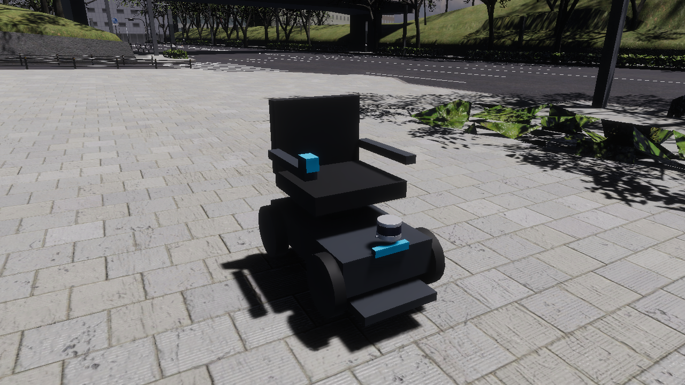
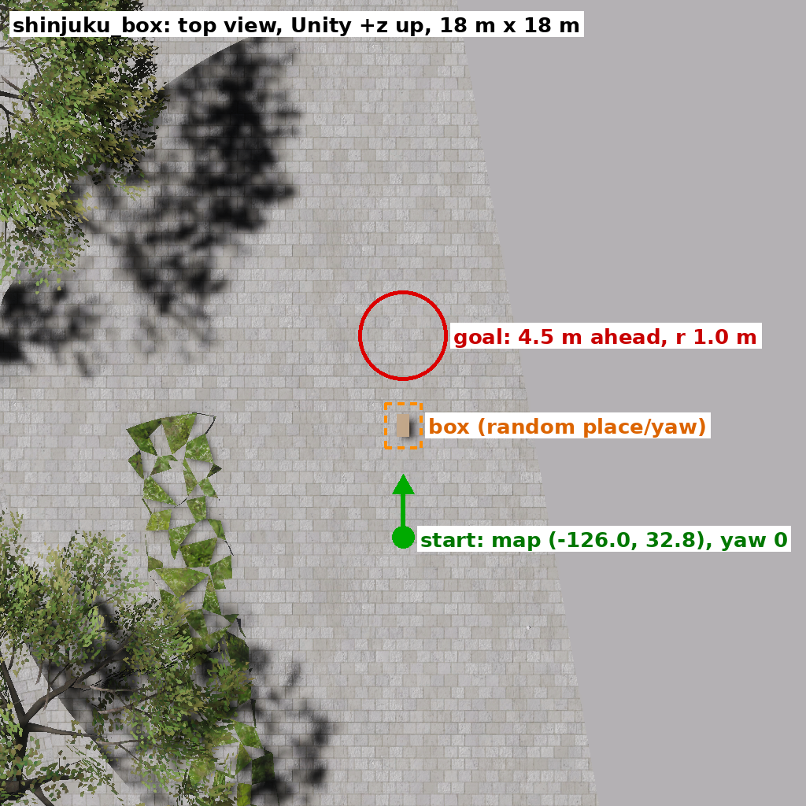
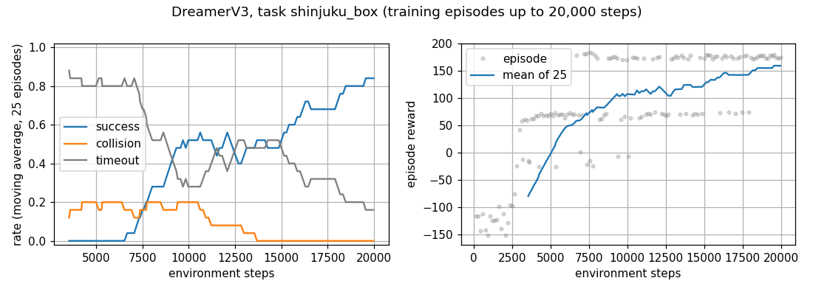
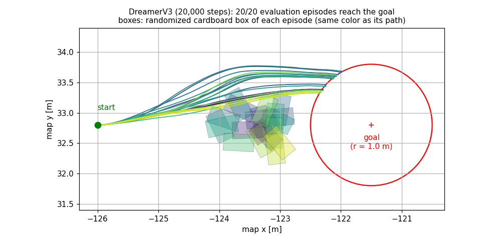

# AWSIM for WHILL

AWSIM-based simulation of the **WHILL Model CR** electric wheelchair in the **West Shinjuku** map of
AWSIM: a differential-drive vehicle model whose physics parameters were optimized against a real
WHILL, ROS 2 (Humble) control with `geometry_msgs/Twist`, ground-truth odometry, an
infrastructure LiDAR, the parameter optimizer (Optuna) with the real-WHILL recordings, and an
end-to-end reinforcement-learning environment (camera → velocity) with DreamerV3, in which tasks
are set anywhere in West Shinjuku and the model is a replaceable module.

It is a derivative of [AWSIM](https://github.com/autowarefoundation/AWSIM) (TIER IV / Autoware
Foundation), commit `fa1dc65` (between v2.0.0 and v2.0.1). The original 3D model of the
WHILL Model CR is **not included**; the vehicle uses a placeholder made of Unity primitives with
the same physics.



*The WHILL Model CR placeholder (Unity primitives, with the vehicle-mounted VLP16) at its start
pose in West Shinjuku, rendered by `WhillSceneTools.CapturePreviewBatch`. Map: AWSIM Shinjuku,
CC BY-NC.*

> Status: research software. What was actually tested, and how, is listed in
> [docs/TEST_REPORT.md](docs/TEST_REPORT.md). Japanese: [README_ja.md](README_ja.md).

## Features

| Feature | State |
|---|---|
| WHILL Model CR differential drive (Twist → inverse kinematics → per-wheel PID) with the optimized parameters | tested (drive/turn/stop in West Shinjuku) |
| Public placeholder 3D model (primitives), physics identical to the original prefab | tested (parameter export before/after) |
| West Shinjuku map (AWSIM Externals, downloaded from the official release and imported by `scripts/setup.sh`) as default environment | tested (setup run on a tree without map, `Library/` and builds, as after a clone) |
| ROS 2: cmd_vel, gear, `/ground_truth/odom`, wheel speeds, camera, vehicle LiDAR, `/clock` | tested (rates measured) |
| Infrastructure LiDAR (Ouster OS1-64) from `config/infra_lidar.yaml`, `/tf_static` | tested (sees the WHILL) |
| Keyboard driving in the AWSIM window (arrow keys, Shift faster, C back to ROS 2) | tested (key events sent to the window; not tried by hand) |
| Keyboard driving from a terminal (`ros2_examples/teleop_keyboard.py`, publishes `cmd_vel`) | tested (key events sent through a pseudo terminal; not tried by hand) |
| Vehicle parameter optimizer (Optuna) with the included real-WHILL recordings | tested (re-evaluation and short optimization in West Shinjuku) |
| RL tasks anywhere in West Shinjuku (task YAML: start poses, goal, limits, reward; start/goal put on the ground by AWSIM), obstacles placed in the Unity Editor, collisions with obstacles and with the map | tested (default task on a sidewalk with a cardboard box; collisions with box, building, shrubs) |
| Learning environment separated from the model (`rl/whill_env/` vs `rl/agents/`), template for your own model | tested (`random`, `my_agent`, `dreamerv3` through the same `train.py` / `evaluate.py`) |
| DreamerV3 training, checkpoints, resume (with replay buffer), evaluation | tested: 20 000 steps (35 min) on the default task → **100 % success** (20/20 evaluation episodes); not converged, room for further learning |
| Pretrained DreamerV3 model for the default task, 20 000 steps (`scripts/fetch_pretrained.sh`, CC BY-NC 4.0) | package tested locally (5/5 successes); the GitHub Release is created with the publication |
| ns-3 network co-simulation | design only ([docs/NS3_INTEGRATION.md](docs/NS3_INTEGRATION.md)) |
| NPC vehicles and pedestrians (upstream AWSIM) | **can be placed, not active by default**: assets in `Assets/Awsim/Prefabs/Entity/Npc/` (vehicles: Hatchback, SmallCar, Taxi, Truck_2t, Van; pedestrians: humanCasual, humanElegant; HDRP and URP); upstream `TrafficSimulator` and pedestrian walker components; no traffic and no walking pedestrians in the default scene, not tested |
| Resource measurement with 1-16 infrastructure LiDARs / WHILLs (`scripts/bench_resources.sh`) | tested ([docs/RESOURCE_USAGE.md](docs/RESOURCE_USAGE.md)) |
| Several WHILLs | one in the shipped scene; more can be added in the Unity Editor (see "Several WHILLs"; not implemented or tested) |

## System requirements

Tested configuration (others are untested):

| | |
|---|---|
| OS | Ubuntu 22.04.5 LTS (x86_64) |
| GPU | NVIDIA GeForce RTX 5090 (32 GB), driver 580.178.04. AWSIM needs an NVIDIA GPU with Vulkan; the LiDAR simulation (RGL) uses CUDA/OptiX |
| CPU / RAM | AMD Ryzen Threadripper 9960X / 256 GB (upstream AWSIM recommends ≥ 32 GB RAM, ≥ 8 GB VRAM) |
| Unity | **6000.0.34f1** exactly (`ProjectSettings/ProjectVersion.txt`) with the "Linux Build Support (Mono)" module, via Unity Hub, with a valid Unity license (Personal is fine; batchmode needs Unity Hub signed in) |
| ROS 2 | Humble, `rmw_cyclonedds_cpp` — provided by the Docker images; a native installation works too |
| Docker | 29.4 with Compose v5 and the NVIDIA Container Toolkit |
| Network | ≈ 1.5 GB download for the West Shinjuku map (once) |
| Disk | ≈ 0.5 GB repository, 1.5 GB map package (+ ≈ 3 GB imported), ≈ 7–10 GB Unity `Library/`, 2 GB per player build, 0.5 GB per DreamerV3 checkpoint |

## Installation

```bash
# 1. Clone (with the DreamerV3 submodule)
git clone --recurse-submodules https://github.com/azu-lab/AWSIM_for_WHILL.git
cd AWSIM_for_WHILL

# 2. Unity 6000.0.34f1: install with Unity Hub (Installs > Install Editor > Archive), add the
#    "Linux Build Support (Mono)" module, and stay signed in to Unity Hub.
#    The scripts find Unity in ~/Unity/Hub/Editor/<version> (or set UNITY_BIN=/path/to/Unity).

# 3. Kernel buffer for large point clouds (recommended)
sudo sysctl -w net.core.rmem_max=2147483647

# 4. One-time setup: West Shinjuku map (download + import), ROS 2 Docker image, AWSIM player.
#    Close the Unity Editor first. Takes 30–60 min the first time.
scripts/setup.sh                     # WITH_DREAMER=1 scripts/setup.sh  for reinforcement learning
```

The map is not part of this repository (AWSIM asset, CC BY-NC). `scripts/setup.sh` downloads it
from the official AWSIM release and imports it. To do this by hand (e.g. behind a proxy):

```bash
# download (1.47 GB) from the AWSIM v2.0.0 release page: https://github.com/tier4/AWSIM/releases/tag/v2.0.0
curl -L -o ~/Downloads/Shinjuku.unitypackage \
    https://github.com/tier4/AWSIM/releases/download/v2.0.0/Shinjuku.unitypackage
# import it into Assets/Awsim/Externals/ (Unity in batchmode), then run the rest of the setup
SHINJUKU_PACKAGE=~/Downloads/Shinjuku.unitypackage scripts/setup.sh
```

(or, in the Unity Editor: Assets > Import Package > Custom Package… > `Shinjuku.unitypackage` >
Import all). Without the map the default scene has no ground and the WHILL falls.

`scripts/setup.sh` runs these steps, which can also be run one by one:

| Step | Command |
|---|---|
| Download the West Shinjuku map from the AWSIM v2.0.0 release (`Shinjuku.unitypackage`, CC BY-NC) and import it into `Assets/Awsim/Externals/` | `scripts/fetch_shinjuku_map.sh` (set `SHINJUKU_PACKAGE=/path/Shinjuku.unitypackage` to reuse a download) |
| ROS 2 tools image (and the DreamerV3 image) | `docker compose -f docker/compose.yaml build ros2` (then `... build dreamer`) |
| AWSIM player of the default scene | `scripts/build_player.sh` → `Builds/AWSIM_for_WHILL/AWSIM_for_WHILL.x86_64` |

To work in the Editor (edit scenes, place obstacles, press Play instead of running the player):

```bash
scripts/open_editor.sh                                          # default scene (West Shinjuku)
scripts/open_editor.sh Assets/Awsim/Scenes/WhillOpenField.unity # another scene
ROS_DOMAIN_ID=77 scripts/open_editor.sh &                       # other domain, keep the terminal
```

It starts Unity 6000.0.34f1 on this project with ROS 2 removed from the environment and the DDS
settings of the other scripts, and opens the scene. While the Editor is open, the batchmode scripts
(`setup.sh`, `build_player.sh`, `setup_scenes.sh`, …) refuse to run; close it first. When opening it
with Unity Hub, do so **from a shell where ROS 2 is not sourced** (Ros2ForUnity ships its own
ROS 2 libraries; with `/opt/ros/humble` in `LD_LIBRARY_PATH` Unity crashes or publishes nothing).

## Quick start: drive the WHILL in West Shinjuku

```bash
scripts/run_awsim.sh        # AWSIM window
```

The WHILL starts on the sidewalk of West Shinjuku where the parameters were optimized
(Unity (−30, −7.37, −140), map (−140, 30)), with the optimized parameters
(`config/vehicle/whill_model_cr_optimized_4scenario_v2.yaml`). Three ways to drive it:

### 1. Keyboard in the AWSIM window

Click the AWSIM window, then:

| Key | Action |
|---|---|
| ↑ / ↓ (held) | forward / backward at 0.5 m/s; released: stop |
| ← / → (held) | turn left / right at 0.5 rad/s; with ↑ / ↓: curve |
| Left Shift (held) | × 2 (1.0 m/s, 1.0 rad/s) |
| C | give the control back to ROS 2 (`cmd_vel`) |

The first arrow key switches AWSIM from *Autonomous* (ROS 2 commands) to *Manual* (keyboard).
**In Manual, `cmd_vel` is ignored** — also the commands of the examples, of `rl/` and of the
optimizer — **until C is pressed in the window.** The gear keys of AWSIM (D, R, N, P) also work in
Manual; the WHILL starts in D, and in P it does not move. Speeds: `_linearVelocity`, `_yawRate`,
`_fastMultiplier` of the `AccelVehicleKeyboardInput` component of the vehicle.

### 2. ROS 2 (`geometry_msgs/Twist` on `/whill/controller/cmd_vel`)

```bash
# automatic check: forward, backward, turns, stops, judged from the odometry
scripts/ros2_shell.sh python3 ros2_examples/drive_test.py

# by hand
scripts/ros2_shell.sh
ros2 topic pub --once /control/command/gear_cmd autoware_vehicle_msgs/msg/GearCommand "{command: 2}"
ros2 topic pub -r 10 /whill/controller/cmd_vel geometry_msgs/msg/Twist "{linear: {x: 0.3}, angular: {z: 0.2}}"
ros2 topic echo /ground_truth/odom
```

The gear command (DRIVE) is required once. Publishers must use TRANSIENT_LOCAL durability
(`ros2 topic pub` does by default; rclpy/rclcpp publishers do not), see
[docs/ROS2_EXAMPLES.md](docs/ROS2_EXAMPLES.md). `ROS_DOMAIN_ID` defaults to 0 in the scripts.

### 3. Keyboard in a terminal (over ROS 2)

```bash
scripts/ros2_shell.sh python3 ros2_examples/teleop_keyboard.py
```

w / s: speed ±0.1 m/s, a / d: turn ±0.1 rad/s, space: stop, q: quit. The keys go to this
terminal and the speed is kept after a key is released; it publishes `cmd_vel` like any ROS 2
node (so it needs AWSIM in Autonomous, see above). Useful on a remote machine or with AWSIM in
the background.

## Scenes

| Scene | Map | Use | Player |
|---|---|---|---|
| `Assets/Awsim/Scenes/AutowareSimulationDemo.unity` (**default**) | West Shinjuku (needs `scripts/fetch_shinjuku_map.sh`) | driving, optimization, infrastructure LiDAR, reinforcement learning (cardboard box of the default task under `TaskObstacles`) | `scripts/build_player.sh` |
| `Assets/Awsim/Scenes/WhillOpenField.unity` | flat 200 m × 200 m ground | optimization without the Shinjuku map | `AWSIM_BUILD_SCENE=Assets/Awsim/Scenes/WhillOpenField.unity AWSIM_BUILD_OUTPUT=$PWD/Builds/AWSIM_for_WHILL_OpenField/AWSIM_for_WHILL.x86_64 scripts/build_player.sh` |

Run another player with `AWSIM_BIN=<path> scripts/run_awsim.sh`. The scenes are generated from
layouts in code (`scripts/setup_scenes.sh`, `scripts/setup_open_field_scene.sh`,
`WhillSceneTools.cs`).

## Vehicle model

- Prefab `Assets/Awsim/Prefabs/Entity/EgoVehicle/WhillModelCR/WhillModelCR.prefab`: physics root
  (Rigidbody 55 kg, AccelVehicle), `Colliders` (4 WheelColliders, body box), `VisualRoot`
  (placeholder, no colliders), sensors.
- Drive wheels r = 0.1345 m, casters r = 0.13 m, track 0.496 m, wheelbase 0.60 m, max. 1.667 m/s.
- `v_L,R = v ∓ (0.496/2)·ω`, per-wheel PID (Kp 27.7, Ki 0.40, Kd 0.74), lateral damping,
  rolling/air drag — the best result of the 4-scenario optimization (straight, turn, circle,
  S-curve); the best result of the 3-scenario optimization is kept in
  `config/vehicle/whill_model_cr_optimized_3scenario_v2.yaml`.
- base_link = center of the drive axle (`RealAxle_center`).

Details, parameter provenance and the placeholder: [docs/VEHICLE_MODEL.md](docs/VEHICLE_MODEL.md).

## Infrastructure LiDAR

One Ouster OS1-64 on the building side of the sidewalk, 12 m ahead of the WHILL's start pose,
3 m above the ground, looking back at it: `/infrastructure/lidar_0/points`
(`sensor_msgs/PointCloud2`, frame `infrastructure_lidar_0`, 10 Hz, ≈60 000 points, best effort)
and `map → infrastructure_lidar_0` on `/tf_static`. Sensors are defined in
[`config/infra_lidar.yaml`](config/infra_lidar.yaml) (model, pose, topic, frame, rate, QoS; add list
entries for more sensors) and written
into the scenes with:

```bash
scripts/setup_scenes.sh && scripts/build_player.sh
scripts/ros2_shell.sh python3 ros2_examples/infra_lidar_check.py   # with AWSIM running
```

## ROS 2 interface

| Direction | Topic | Type |
|---|---|---|
| in | `/whill/controller/cmd_vel` | `geometry_msgs/Twist` (linear.x m/s, angular.z rad/s) |
| in | `/control/command/gear_cmd` | `autoware_vehicle_msgs/GearCommand` (2 = DRIVE) |
| in | `/reset_command`, `/awsim/episode/start_pose`, `/awsim/episode/goal` | `std_msgs/Bool`, `geometry_msgs/Pose`, `geometry_msgs/Point` (the RL environment resets over TCP instead, `reset_episode` on 127.0.0.1:50051) |
| out | `/ground_truth/odom` | `nav_msgs/Odometry` (map → base_link, 20 Hz) |
| out | `/infrastructure/lidar_0/points`, `/sensing/lidar/top/pointcloud_raw` | `sensor_msgs/PointCloud2` (10 Hz) |
| out | `/sensing/camera/front/image_raw` | `sensor_msgs/Image` (1920×1080, 10 Hz) |
| out | `/whill/wheel_velocities_sim`, `/collision_sensor`, `/awsim/goal_position`, `/tf_static`, `/clock` | |

Full specification (QoS, frames, time, limitations): [docs/ROS2_INTERFACE.md](docs/ROS2_INTERFACE.md).

## Parameter optimization

`optimizer/whill_optimizer` searches 13 AccelVehicle parameters with Optuna (TPE) to minimize the
trajectory RMSE between AWSIM and recordings of a real WHILL replayed through `cmd_vel`. The
recordings are included in [`data/real_whill/`](data/real_whill/README.md) (straight, turn, circle,
S-curve, lemniscate) and the default scene is the place where the original optimization was run.

```bash
scripts/run_awsim.sh                                                          # terminal 1
scripts/ros2_shell.sh bash -c "cd optimizer && python3 -m whill_optimizer test-rosbag"
scripts/ros2_shell.sh bash -c "cd optimizer && python3 -m whill_optimizer optimize --trials 500 \
    --scenarios straight,turn,circle,s_curve --db-path /workspace/outputs/opt/study.db \
    --results-json /workspace/outputs/opt/results.json --output-dir /workspace/outputs/opt/visualization"
scripts/ros2_shell.sh bash -c "cd optimizer && python3 -m whill_optimizer apply-params \
    --yaml ../config/vehicle/whill_model_cr_optimized_4scenario_v2.yaml"
```

See [docs/PARAMETER_OPTIMIZATION.md](docs/PARAMETER_OPTIMIZATION.md) (method, results,
re-evaluation, applying parameters).

## Reinforcement learning (DreamerV3 or your own model)

End-to-end learning from the front camera (64×64 RGB) to `(v, ω)`, by default **in West Shinjuku**
with the default player: the WHILL starts on a sidewalk, the goal is 4.5 m ahead, a cardboard box
stands in between (moved at every reset); buildings, curbs and shrubs of the map also end an
episode as collisions. Reward and termination: +100 goal, 30·progress, −50
collision, −0.05 per step, −1.0·|Δω|; truncated after 150 steps.



```bash
WITH_DREAMER=1 scripts/setup.sh                       # once: also the DreamerV3 image
scripts/run_awsim.sh                                  # terminal 1
D="env IMAGE=awsim-for-whill/dreamer scripts/ros2_shell.sh"
$D python3 rl/tools/check_task.py --episodes 10                              # is the task solvable?
$D python3 rl/evaluate.py --agent random --episodes 2 --verbose            # check the environment
$D python3 -u rl/train.py --agent dreamerv3 --logdir logs/rl/shinjuku_box --steps 20000
$D python3 rl/evaluate.py --logdir logs/rl/shinjuku_box --episodes 10
$D tensorboard --logdir logs/rl --bind_all                                  # http://localhost:6006
```

`shinjuku_box` is a **new task that was not part of the experiments at the time of the paper
submission** (arXiv:2609.28969). It differs from the simulated obstacle-avoidance setting of the
paper in the velocity limits (here 0.3 m/s and 0.6 rad/s without reverse; paper 1.0 m/s and
1.0 rad/s with reverse) and in the smoothness term (here −1.0·|a_ω,t − a_ω,t−1| on the
normalized angular action at every non-terminal step; paper −1.0·|ω_t − ω_t−1| on the angular
velocity in rad/s while moving).

With these defaults (10 Hz decision steps, 150-step limit) DreamerV3 reached the goal in
**20 of 20 evaluation episodes after 20 000 steps** (35 min on an RTX 5090; first success after
6 677 steps; training episodes 15 000–20 000: 86 % success, 0 % collision, 14 % timeout):





**There is still room for further learning.** The policy is not converged: a successful episode
takes 128–146 of the 150 steps, so a slightly longer path ends in a timeout. Longer training,
another step limit, other seeds or tuned hyper-parameters may improve it (details:
[docs/DREAMER_TRAINING.md §10](docs/DREAMER_TRAINING.md)).

The trained model (20 000 steps) is available without training (CC BY-NC 4.0, 144 MB):

```bash
scripts/fetch_pretrained.sh
$D python3 rl/evaluate.py --logdir pretrained/shinjuku_box_dreamerv3 --episodes 10
```

Where to put what ([rl/README.md](rl/README.md)):

| | Where |
|---|---|
| **your model** | `rl/agents/` — copy `my_agent.py` (interface `rl/agents/base.py`), run it with `--agent` |
| **the task** (place in West Shinjuku, goal, limits, reward) | a YAML in `rl/configs/tasks/` |
| **obstacles** | the scene, with the Unity Editor (`scripts/open_editor.sh`) |
| learning environment (observation, reward, end of episode, action → Twist) | `rl/whill_env/env.py` |
| communication with AWSIM (ROS 2, reset) | `rl/whill_env/data_manager.py` |

Details (task file, choosing coordinates, placing obstacles, DreamerV3 settings, outputs):
[docs/DREAMER_TRAINING.md](docs/DREAMER_TRAINING.md).

## Project structure

```
Assets/ Packages/ ProjectSettings/   Unity project (AWSIM fork)
  Assets/Awsim/Prefabs/Entity/EgoVehicle/WhillModelCR/   WHILL Model CR prefab + placeholder
  Assets/Awsim/Scenes/AutowareSimulationDemo.unity       default scene (West Shinjuku)
  Assets/Awsim/Scenes/WhillOpenField.unity               obstacle-free scene (optimization)
  Assets/Awsim/Externals/                                West Shinjuku map (downloaded, not in Git)
  Assets/Awsim/Scripts/{DreamerV3,Optimizer,InfraLidar}/ fork-specific runtime code
  Assets/Awsim/Scripts/Editor/{WhillModelCR,InfraLidar,Build}/  editor / batchmode tools
config/          infra_lidar*.yaml, cyclonedds.xml, vehicle/ (parameter sets), optimizer/
data/real_whill/ recordings of a real WHILL (optimization reference)
optimizer/       whill_optimizer (Optuna), real-WHILL recording / replay tools
rl/              reinforcement learning: whill_env/ (environment), agents/ (models: DreamerV3,
                 template), configs/tasks/, train.py, evaluate.py, tools/ (real WHILL)
ros2_examples/   teleop, drive / interface / LiDAR / reset tests
scripts/         setup, map download, build, run, Unity batchmode helpers, Docker shell,
                 resource measurement (bench_resources.sh, bench/)
docker/          ROS 2 tools image, DreamerV3 image
third_party/dreamerv3   DreamerV3 (submodule, b65cf81)
docs/            documentation of this project
```

## Resource usage with more LiDARs / WHILLs

How RAM, VRAM, CPU and frame rate of AWSIM grow with the number of infrastructure LiDARs and
WHILLs, to estimate the hardware for a scenario. The copies are made at start-up by
`Assets/Awsim/Scripts/Benchmark/ResourceBenchmarkSpawner.cs` (environment variables
`AWSIM_BENCH_*`; without them it does nothing), so the default player is used unchanged.

**Conditions** (`config/resource_bench.yaml`)

| | |
|---|---|
| Series A | infrastructure LiDARs 1, 2, 4, 8, 16 — WHILLs 1 |
| Series B | WHILLs 1, 2, 4, 8, 16 — infrastructure LiDARs 1 |
| Infrastructure LiDAR | Ouster OS1-64, 10 Hz (`config/infra_lidar.yaml`); copies every 4 m along the WHILL heading, same height and orientation, topics `/bench/infra_lidar_<i>/points` |
| WHILL | `WhillModelCR` prefab with its camera (1920×1080, 10 Hz); **vehicle LiDAR (VLP16) switched off** (`vehicle_lidar: false`); copies on the sidewalk at the places of `whill_positions`, put on the ground; camera topics `/bench/whill_<i>/camera/image_raw` |
| Command | all WHILLs spin in place (v = 0 m/s, ω = 0.5 rad/s, one `cmd_vel` for all) |
| Timing per condition | start, scene loaded + 10 s, command; sensor topics counted 15–21 s after the command; 60 s warm-up, then 60 s recorded at 1 Hz |
| Measured | RSS and CPU of the AWSIM process (psutil), VRAM of the AWSIM process (`nvidia-smi pmon`), frame rate counted inside AWSIM (5 s windows), output rate of every LiDAR / camera, position and yaw rate of every WHILL (all must keep turning); GPU utilization of the whole GPU as a reference (the per-process value of NVML is unreliable) and 60 s without AWSIM as baseline |
| Player | default build `Builds/AWSIM_for_WHILL`, West Shinjuku, window 1280×720, quality Ultra (VSync on: at most 60 FPS on a 60 Hz display) |
| PC | the tested configuration of "System requirements" (Threadripper 9960X, RTX 5090, 256 GB) |

**Commands** (needs on the host `python3` with `psutil` and `nvidia-smi`; the `ros2` and `dreamer`
Docker images; close every other AWSIM first, its load would be measured too)

```bash
scripts/run_awsim.sh --stop
scripts/bench_resources.sh                    # all 9 conditions, ~25 min -> logs/resource_bench/<date>/
scripts/bench_resources.sh --only 1,4         # one condition (LiDARs,WHILLs)
scripts/bench_resources.sh --report logs/resource_bench/<date>   # summary and figures again
```

Output per run: `summary.csv`, `results_table.md`, `fig1_infra_lidar.png`, `fig2_whill.png`, and per
condition the 1 Hz samples, the AWSIM log, the counted topic rates and the WHILL status lines.

**Result on the tested PC** (2026-10-16, details and figures: [docs/RESOURCE_USAGE.md](docs/RESOURCE_USAGE.md)):

| | RAM | VRAM | CPU | frame rate |
|---|---:|---:|---:|---|
| base: 1 LiDAR, 1 WHILL | 3.75 GiB | 6.21 GiB | 2.8 cores | 60 FPS |
| per additional infrastructure LiDAR | +12 MiB | +71 MiB | +0.03 core | 60 FPS with 16 |
| per additional WHILL (camera 1920×1080, 10 Hz) | +72 MiB | +118 MiB | +0.34 core | 60 FPS with 8; 56 FPS (camera 9 Hz) with 16 |

## Several WHILLs (how to add a second one)

The scene drives one WHILL. More can be added in the Unity Editor (`scripts/open_editor.sh`);
independently controlled WHILLs have **not been implemented or tested** in this repository.
`Assets/Awsim/Scripts/Benchmark/ResourceBenchmarkSpawner.cs` (used for the resource
measurement, up to 16 WHILLs) does steps 1-3 at start-up and can serve as an example; it keeps one
`cmd_vel` for all copies. What has to be done:

1. **Place another vehicle.** Drag `Assets/Awsim/Prefabs/Entity/EgoVehicle/WhillModelCR/WhillModelCR.prefab`
   into the scene. The prefab contains everything of one vehicle, including its `EgoVehicle`
   component (vehicle, inputs, camera) and an `OptimizerBridge`; remove the `OptimizerBridge` of
   the second WHILL (it would try to open the same TCP port).
2. **Give it its own topics, frames and node names** (Inspector overrides of the new instance), e.g.
   with the prefix `/whill2`:

   | Component (in the prefab) | Fields |
   |---|---|
   | `AccelVehicleRos2Input` | `_cmdVelTopic`, `_gearCommandTopic` (and the other command topics) |
   | `GroundTruthPublisher` | `topicName`, `childFrameId` |
   | `CameraRos2Publisher` | `_imageTopic`, `_cameraInfoTopic`, `_frameId` |
   | `RglLidarPublisher` | `frameId`, `topic` of each publishing entry |
   | `CollisionPublisher` | `_topicName` |
   | `WheelSpeedPublisher` | `topicName`, `nodeName` (node names must be unique) |
   | `AccelVehicleReportRos2Publisher` | the `/vehicle/status/*` topics, `_frameId` |

3. **Let the scene update every vehicle.** `AutowareSimulationDemo` (`Assets/Awsim/Scenes/AutowareSimulationDemo/AutowareSimulationDemo.cs`)
   holds one `_egoVehicle` and calls its `Initialize`, `OnUpdate` and `OnFixedUpdate`; a second
   `EgoVehicle` is never initialized and does not drive. Change the field to an array and call
   these methods for each element (the UI windows can stay bound to the first vehicle).
4. **Resets and tools** (only if needed): add a second `EnvironmentReset` (object `DreamerV3Manager`)
   with its `_wheelchairTransform`, `_wheelchairRigidbody`, `_accelVehicle` set to the new WHILL
   and its own topics; the TCP request `reset_episode` and the `OptimizerBridge` (port 50051) act
   on the first vehicle only. In `rl/` and `ros2_examples/`, use the new topics (`topics:` of
   the task file).

Details of what collides between two instances: [docs/ROS2_INTERFACE.md §5](docs/ROS2_INTERFACE.md).

## Differences from AWSIM

Differential-drive AccelVehicle and Twist input; WHILL prefab instead of the Lexus (kept,
inactive); an RL task obstacle in West Shinjuku; ground-truth,
wheel-speed, collision (obstacles and map) and reset (start pose / goal on the ground)
components; optimizer bridge; infrastructure LiDAR with `/tf_static`; NPC traffic and V2I kept
but unused. Upstream documentation is not included (license). Details:
[docs/UPSTREAM_DIFF.md](docs/UPSTREAM_DIFF.md).

## Limitations

- One WHILL per AWSIM instance as shipped; more can be added (see "Several WHILLs", not tested).
- The West Shinjuku map must be downloaded (1.4 GB) and imported before the default scene works;
  without it the WHILL has no ground.
- After an arrow key was pressed in the AWSIM window, AWSIM is in *Manual* mode and **`cmd_vel`
  (also from `rl/` and the optimizer) is ignored until C is pressed in the window**.
- No `/tf` for the vehicle; IMU/GNSS not published.
- The default vehicle parameters are the best result of the 4-scenario optimization; the 3-scenario
  result and the state of the scene of the original work (`whill_model_cr_soturon_scene.yaml`)
  are kept in `config/vehicle/` and can be applied with `apply-params`
  ([docs/VEHICLE_MODEL.md §4](docs/VEHICLE_MODEL.md)).
- NPC vehicles and pedestrians are not active by default (no traffic, the pedestrians of the scene
  do not walk); their assets are included and can be placed (see Features).
- Reinforcement learning: one DreamerV3 training run (one seed) on the default task was made;
  other tasks were checked only with the scripted driver / random actions. On GPUs with compute
  capability ≥ 12 DreamerV3 computes in float32 instead of float16 (jax 0.4.33). Obstacles are
  scene objects (Unity Editor), not placed per episode from Python.
- The placeholder model changes what LiDARs and cameras see of the WHILL itself (not its physics).
- In the player window the follow camera (6 m behind, 3 m above the WHILL) can be blocked by trees
  or walls; use the "Follow camera" UI (shift + mouse wheel to zoom) or the Editor scene view.

## License

Follows the [AWSIM License](LICENSE): code (`*.cs`, …) **Apache 2.0**; AWSIM assets — including the
West Shinjuku map downloaded by the setup — **CC BY-NC** (non-commercial); AWSIM documentation
may not be republished (not included). Code, data and files added by this project: Apache 2.0.
DreamerV3 (submodule): MIT. Third-party plugins keep their licenses. Details:
[docs/ASSETS_AND_LICENSES.md](docs/ASSETS_AND_LICENSES.md), [NOTICE](NOTICE).

## Acknowledgements

- [AWSIM](https://github.com/autowarefoundation/AWSIM) and its West Shinjuku map by TIER IV, Inc.
  and the Autoware Foundation.
- [Robotec GPU Lidar](https://github.com/RobotecAI/RobotecGPULidar) and
  [ROS2 For Unity](https://github.com/RobotecAI/ros2-for-unity) by Robotec.ai.
- [DreamerV3](https://github.com/danijar/dreamerv3) by Danijar Hafner.
- [Optuna](https://optuna.org/), [ROS 2](https://docs.ros.org/en/humble/), [Eclipse Cyclone DDS](https://cyclonedds.io/).
- WHILL and Model CR are products of WHILL, Inc. This project is not affiliated with or endorsed by
  WHILL, Inc.; the simulated vehicle is a model built for research.
