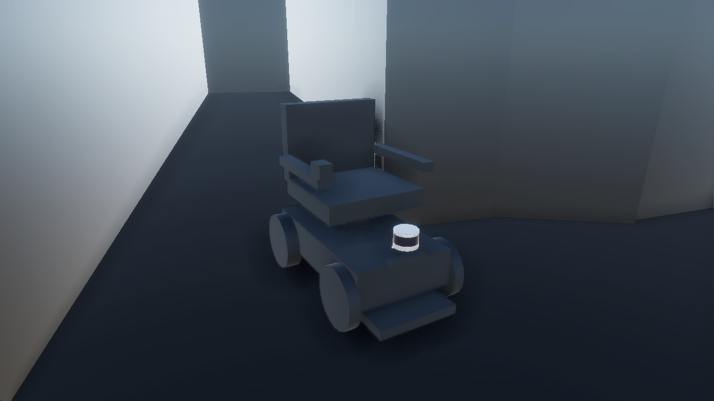

# AWSIM for WHILL

AWSIM-based simulation of the **WHILL Model CR** electric wheelchair: a differential-drive vehicle
model with physics parameters fitted to a real WHILL, ROS 2 (Humble) control with
`geometry_msgs/Twist`, ground-truth odometry, an infrastructure LiDAR, a corridor scene with
obstacles, a parameter optimizer (Optuna) and a DreamerV3 reinforcement-learning environment.

It is a derivative of [AWSIM](https://github.com/autowarefoundation/AWSIM) (TIER IV / Autoware
Foundation), commit `fa1dc65` (between v2.0.0 and v2.0.1). The original 3D model of the
WHILL Model CR is **not included**; the vehicle uses a placeholder made of Unity primitives with
the same physics.



*The public placeholder of the WHILL Model CR (Unity primitives, with the vehicle-mounted VLP16)
in the corridor scene, rendered by `WhillSceneTools.CapturePreviewBatch`.*

> Status: research software. What was actually tested, and how, is listed in
> [docs/TEST_REPORT.md](docs/TEST_REPORT.md). Japanese: [README_ja.md](README_ja.md).

## Features

| Feature | State |
|---|---|
| WHILL Model CR differential drive (Twist → inverse kinematics → per-wheel PID), optimized physics parameters | tested (drive/turn/stop) |
| Public placeholder 3D model (primitives), physics identical to the original prefab | tested (parameter export before/after) |
| ROS 2: cmd_vel, gear, `/ground_truth/odom`, wheel speeds, camera, vehicle LiDAR, `/clock` | tested (rates measured) |
| Infrastructure LiDAR (Ouster OS1-64) from `config/infra_lidar.yaml`, `/tf_static` | tested (sees the WHILL) |
| Corridor with obstacles, collision events, episode reset, start pose / goal over ROS 2 | tested |
| Vehicle parameter optimizer (Optuna, real-WHILL rosbags) | pipeline tested (needs recordings of a real WHILL, not included) |
| DreamerV3 (camera) obstacle-avoidance environment, training, checkpoints, resume | short training tested (400–500 steps); learning performance not verified |
| ns-3 network co-simulation | design only ([docs/NS3_INTEGRATION.md](docs/NS3_INTEGRATION.md)) |
| Several WHILLs | not supported ([docs/ROS2_INTERFACE.md §5](docs/ROS2_INTERFACE.md)) |

## System requirements

Tested configuration (others are untested):

| | |
|---|---|
| OS | Ubuntu 22.04.5 LTS (x86_64) |
| GPU | NVIDIA GeForce RTX 5090 (32 GB), driver 580.178.04. AWSIM needs an NVIDIA GPU with Vulkan; the LiDAR simulation (RGL) uses CUDA/OptiX |
| CPU / RAM | AMD Ryzen Threadripper 9960X / 256 GB (upstream AWSIM recommends ≥ 32 GB RAM, ≥ 8 GB VRAM) |
| Unity | **6000.0.34f1** exactly (`ProjectSettings/ProjectVersion.txt`), via Unity Hub, with a valid Unity license (Personal is fine; batchmode needs Unity Hub signed in) |
| ROS 2 | Humble, `rmw_cyclonedds_cpp` — provided by the Docker images; a native installation works too |
| Docker | 29.4 with Compose v5 and the NVIDIA Container Toolkit (for the Python tools / DreamerV3) |
| Disk | ≈ 1 GB repository, ≈ 7–10 GB Unity `Library/` after import, 2 GB player build, 0.5 GB per DreamerV3 checkpoint |

## Installation

```bash
# 1. Clone (with the DreamerV3 submodule)
git clone --recurse-submodules https://github.com/shoumexi-03/AWSIM_for_WHILL.git
cd AWSIM_for_WHILL

# 2. Unity 6000.0.34f1: install with Unity Hub (Installs > Install Editor > Archive),
#    add the "Linux Build Support (Mono)" module, sign in to Unity Hub.

# 3. Kernel buffer for large point clouds (recommended)
sudo sysctl -w net.core.rmem_max=2147483647

# 4. Docker images with ROS 2 Humble + tools (and DreamerV3/JAX)
docker compose -f docker/compose.yaml build ros2
docker compose -f docker/compose.yaml build dreamer      # only for reinforcement learning (built on ros2)

# 5. Build the AWSIM player (first time 10–30 min: imports the project).
#    Close the Unity Editor first; scripts/unity_lib.sh finds Unity in ~/Unity/Hub/Editor/<version>
#    (set UNITY_BIN=/path/to/Unity otherwise).
scripts/build_player.sh
```

To work in the Editor instead: open the project folder with Unity Hub **from a shell where ROS 2 is
not sourced** (Ros2ForUnity ships its own ROS 2 libraries; with `/opt/ros/humble` in
`LD_LIBRARY_PATH` Unity crashes or publishes nothing), open
`Assets/Awsim/Scenes/AutowareSimulationDemo.unity` and press Play.

## Quick start

```bash
# Terminal 1: AWSIM (window, corridor scene)
scripts/run_awsim.sh

# Terminal 2: drive the WHILL and check the result (forward, backward, turns, stops)
scripts/ros2_shell.sh python3 ros2_examples/drive_test.py
```

Manual control:

```bash
scripts/ros2_shell.sh
ros2 topic pub --once --qos-reliability reliable --qos-durability transient_local \
  /control/command/gear_cmd autoware_vehicle_msgs/msg/GearCommand "{command: 2}"
ros2 topic pub -r 10 --qos-reliability reliable --qos-durability transient_local \
  /whill/controller/cmd_vel geometry_msgs/msg/Twist "{linear: {x: 0.3}, angular: {z: 0.2}}"
ros2 topic echo /ground_truth/odom
```

The gear command (DRIVE) is required once. Publishers must use TRANSIENT_LOCAL durability
(`ros2 topic pub` does by default; rclpy/rclcpp publishers do not), see
[docs/ROS2_EXAMPLES.md](docs/ROS2_EXAMPLES.md). `ROS_DOMAIN_ID` defaults to 0 in both scripts.

## Vehicle model

- Prefab `Assets/Awsim/Prefabs/Entity/EgoVehicle/WhillModelCR/WhillModelCR.prefab`: physics root
  (Rigidbody 55 kg, AccelVehicle), `Colliders` (4 WheelColliders, body box), `VisualRoot`
  (placeholder, no colliders), sensors.
- Drive wheels r = 0.1345 m, casters r = 0.13 m, track 0.496 m, wheelbase 0.60 m, max. 1.667 m/s.
- `v_L,R = v ∓ (0.496/2)·ω`, per-wheel PID (Kp 27.8, Ki 0.82, Kd 1.00), lateral damping,
  rolling/air drag.
- base_link = center of the drive axle (`RealAxle_center`).

Details, parameter provenance and the placeholder: [docs/VEHICLE_MODEL.md](docs/VEHICLE_MODEL.md).

## Infrastructure LiDAR

One Ouster OS1-64 at the end of the corridor, 2.5 m above the floor, tilted 25° down towards the
WHILL: `/infrastructure/lidar_0/points` (`sensor_msgs/PointCloud2`, frame
`infrastructure_lidar_0`, 10 Hz, ≈43 000 points, best effort) and `map → infrastructure_lidar_0` on
`/tf_static`. Sensors are defined in [`config/infra_lidar.yaml`](config/infra_lidar.yaml)
(model, pose, topic, frame, rate, QoS; add list entries for more sensors) and written into the
scene with:

```bash
scripts/setup_infra_lidar.sh && scripts/build_player.sh
scripts/ros2_shell.sh python3 ros2_examples/infra_lidar_check.py   # with AWSIM running
```

## ROS 2 interface

| Direction | Topic | Type |
|---|---|---|
| in | `/whill/controller/cmd_vel` | `geometry_msgs/Twist` (linear.x m/s, angular.z rad/s) |
| in | `/control/command/gear_cmd` | `autoware_vehicle_msgs/GearCommand` (2 = DRIVE) |
| in | `/reset_command`, `/awsim/episode/start_pose`, `/awsim/episode/goal` | `std_msgs/Bool`, `geometry_msgs/Pose`, `geometry_msgs/Point` |
| out | `/ground_truth/odom` | `nav_msgs/Odometry` (map → base_link, ≈23 Hz) |
| out | `/infrastructure/lidar_0/points`, `/sensing/lidar/top/pointcloud_raw` | `sensor_msgs/PointCloud2` (10 Hz) |
| out | `/sensing/camera/traffic_light/image_raw` | `sensor_msgs/Image` (1920×1080, ≈8 Hz) |
| out | `/whill/wheel_velocities_sim`, `/collision_sensor`, `/awsim/goal_position`, `/tf_static`, `/clock` | |

Full specification (QoS, frames, time, limitations): [docs/ROS2_INTERFACE.md](docs/ROS2_INTERFACE.md).

## Parameter optimization

`optimizer/whill_optimizer` searches 13 AccelVehicle parameters with Optuna (TPE) to minimize the
trajectory RMSE between AWSIM and recordings of a real WHILL replayed through `cmd_vel`.
Recordings of a real WHILL are **not included** (put them in `data/real_whill/` or set
`WHILL_ROSBAG_DIR`). Parameter sets: `config/vehicle/`.

```bash
# AWSIM must run the obstacle-free scene:
AWSIM_BUILD_SCENE=Assets/Awsim/Scenes/WhillOpenField.unity \
AWSIM_BUILD_OUTPUT=$PWD/Builds/AWSIM_for_WHILL_OpenField/AWSIM_for_WHILL.x86_64 scripts/build_player.sh
AWSIM_BIN=$PWD/Builds/AWSIM_for_WHILL_OpenField/AWSIM_for_WHILL.x86_64 scripts/run_awsim.sh

scripts/ros2_shell.sh bash -c "cd optimizer && python3 -m whill_optimizer get-params"
scripts/ros2_shell.sh bash -c "cd optimizer && python3 -m whill_optimizer apply-params \
    --yaml ../config/vehicle/whill_model_cr_optimized_3scenario_v2.yaml"
scripts/ros2_shell.sh bash -c "cd optimizer && python3 -m whill_optimizer optimize --trials 100 \
    --scenarios straight,turn,circle"
```

See [docs/PARAMETER_OPTIMIZATION.md](docs/PARAMETER_OPTIMIZATION.md).

## Reinforcement learning (DreamerV3)

Camera-based obstacle avoidance in the corridor: 64×64 RGB observation, (v, ω) action, reward
+100 goal / −50 collision / 30·progress / −0.05 per step, configurable in
`rl/configs/env/obstacle_avoidance.yaml`.

```bash
docker compose -f docker/compose.yaml build dreamer
scripts/run_awsim.sh                                                       # terminal 1
IMAGE=awsim-for-whill/dreamer scripts/ros2_shell.sh \
    python3 rl/scripts/random_agent.py --episodes 2                        # environment check
IMAGE=awsim-for-whill/dreamer scripts/ros2_shell.sh python3 -u rl/scripts/train.py \
    --task obstacle_avoidance --logdir logs/dreamer/run1 --steps 1000000
```

See [docs/DREAMER_TRAINING.md](docs/DREAMER_TRAINING.md) (hyper-parameters, outputs, evaluation,
RTX 50xx notes).

## Project structure

```
Assets/ Packages/ ProjectSettings/   Unity project (AWSIM fork)
  Assets/Awsim/Prefabs/Entity/EgoVehicle/WhillModelCR/   WHILL Model CR prefab + placeholder
  Assets/Awsim/Scenes/AutowareSimulationDemo.unity       corridor scene (default)
  Assets/Awsim/Scenes/WhillOpenField.unity               obstacle-free scene (optimization)
  Assets/Awsim/Scripts/{DreamerV3,Optimizer,InfraLidar}/ fork-specific runtime code
  Assets/Awsim/Scripts/Editor/{WhillModelCR,InfraLidar,Build}/  editor / batchmode tools
config/          infra_lidar.yaml, cyclonedds.xml, vehicle/ (parameter sets), optimizer/
optimizer/       whill_optimizer (Optuna), real-WHILL recording / replay tools
rl/              DreamerV3 environment (awsim_dreamerv3), scripts, configs
ros2_examples/   drive / interface / LiDAR / reset tests
scripts/         build, run, Unity batchmode helpers, Docker shell
docker/          ROS 2 tools image, DreamerV3 image
third_party/dreamerv3   DreamerV3 (submodule, b65cf81)
docs/            documentation of this project
```

## Differences from AWSIM

Differential-drive AccelVehicle and Twist input; WHILL prefab; corridor/obstacle scene;
ground-truth, wheel-speed, collision and reset components; optimizer bridge; infrastructure
LiDAR with `/tf_static`; Lexus, Shinjuku map, NPCs and V2I kept but inactive. Upstream
documentation is not included (license). Details: [docs/UPSTREAM_DIFF.md](docs/UPSTREAM_DIFF.md).

## Limitations

- One WHILL per AWSIM instance (global topic names, fixed bridge port).
- Not every upstream scene was checked with the modified vehicle model; the Shinjuku map needs the
  AWSIM externals (not included).
- The keyboard does not drive the WHILL; control is through ROS 2 (or the optimizer bridge).
- `/ground_truth/odom` runs below its 30 Hz setting (≈23 Hz, frame-rate bound); no `/tf` for the
  vehicle; IMU/GNSS not published.
- The default vehicle parameters are the best optimization result, which differs from the scene
  used in the original work (and its DreamerV3 training) in two lateral-friction values;
  `config/vehicle/whill_model_cr_soturon_scene.yaml` restores that state
  ([docs/VEHICLE_MODEL.md §4](docs/VEHICLE_MODEL.md)).
- Recordings of the real WHILL and the optimization studies of the original work are not published;
  the optimization can only be re-run with own recordings.
- DreamerV3: only short training runs were tested; on GPUs with compute capability ≥ 12 the
  computation runs in float32 instead of float16 (jax 0.4.33).
- The placeholder model changes what LiDARs and cameras see of the WHILL itself (not its physics).
- In the player window the follow camera (6 m behind, 3 m above the WHILL) is outside the corridor
  walls, so the WHILL is hidden; use the "Follow camera" UI (shift + mouse wheel to zoom) or the
  Unity Editor scene view.

## License

Follows the [AWSIM License](LICENSE): code (`*.cs`, …) **Apache 2.0**; AWSIM assets **CC BY-NC**
(non-commercial); AWSIM documentation may not be republished (not included). Code and files added
by this project: Apache 2.0. DreamerV3 (submodule): MIT. Third-party plugins keep their licenses.
Details and excluded assets: [docs/ASSETS_AND_LICENSES.md](docs/ASSETS_AND_LICENSES.md),
[NOTICE](NOTICE).

## Acknowledgements

- [AWSIM](https://github.com/autowarefoundation/AWSIM) by TIER IV, Inc. and the Autoware Foundation.
- [Robotec GPU Lidar](https://github.com/RobotecAI/RobotecGPULidar) and
  [ROS2 For Unity](https://github.com/RobotecAI/ros2-for-unity) by Robotec.ai.
- [DreamerV3](https://github.com/danijar/dreamerv3) by Danijar Hafner.
- [Optuna](https://optuna.org/), [ROS 2](https://docs.ros.org/en/humble/), [Eclipse Cyclone DDS](https://cyclonedds.io/).
- WHILL and Model CR are products of WHILL, Inc. This project is not affiliated with or endorsed by
  WHILL, Inc.; the simulated vehicle is a model built for research.
