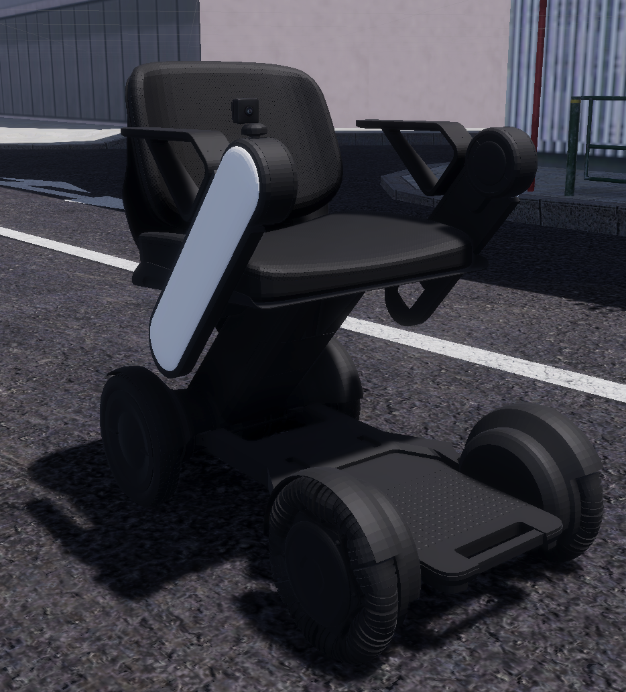

# AWSIM for WHILL（日本語）

電動車椅子 **WHILL Model CR** を [AWSIM](https://github.com/autowarefoundation/AWSIM) の **西新宿マップ** で動かすシミュレーション環境です。
次のものを含みます。

- 実機データで物理パラメータを最適化した差動二輪の車両モデル
- `geometry_msgs/Twist` による ROS 2（Humble）制御、真値オドメトリ、インフラ LiDAR
- 実機 rosbag を同梱したパラメータ最適化ツール（Optuna）
- カメラから速度指令までを学習する強化学習環境
  - 西新宿の任意の場所でタスクを設定できる
  - モデルは DreamerV3 のほか、利用者が実装したものに差し替えられる

AWSIM（TIER IV / Autoware Foundation）のコミット `fa1dc65`（v2.0.0 と v2.0.1 の間）からの派生物です。
WHILL Model CR の元の 3D モデルは**含まれません**。車両の見た目は Unity のプリミティブで作った代替モデルで、物理は元のプレハブと同一です。
WHILL の 3D モデルは別途入手できます（[WHILL の 3D モデル](#whill-の-3d-モデル)を参照）。

論文：S. Amano and T. Azumi, "Sim-to-Real Aware End-to-End Learning Environment for Micromobility," 2026 IEEE/RSJ International Conference on Intelligent Robots and Systems（IROS 2026）採択。リンクと DOI は公開され次第掲載します（引用の形式は[引用](#引用)を参照）。


英語版 [README.md](README.md) が正本です。実際に何をどう確認したかは [docs/TEST_REPORT.md](docs/TEST_REPORT.md) にあります。

## 機能と状態

| 機能 | 状態 |
|---|---|
| 差動二輪（Twist → 逆運動学 → 左右輪 PID）、最適化済みパラメータ | 確認済み（西新宿で前進・後退・旋回・停止） |
| 公開用代替 3D モデル（物理は元と同一） | 確認済み |
| 西新宿マップ（AWSIM Externals、`scripts/setup.sh` が公式リリースから取得して取り込む）を既定の環境に | 確認済み（clone 直後と同じ状態から setup.sh を実行） |
| ROS 2：cmd_vel、ギア、`/ground_truth/odom`、車輪速度、カメラ、車載 LiDAR、`/clock` | 確認済み（周期を実測） |
| インフラ LiDAR（Ouster OS1-64、`config/infra_lidar.yaml`）と `/tf_static` | 確認済み（WHILL を捉える） |
| AWSIM の画面でのキー操縦（矢印キー、Shift で速く、C で ROS 2 に戻す） | 確認済み（画面にキー入力を送って確認。人の手での操作は未確認） |
| 端末からのキー操縦（`ros2_examples/teleop_keyboard.py`、`cmd_vel` を送る） | 確認済み（擬似端末からキー入力を送って確認。人の手での操作は未確認） |
| 同梱の実機 rosbag によるパラメータ最適化 | 確認済み（西新宿で再評価と短い最適化） |
| 強化学習のタスクを西新宿の任意の場所に設定 | 確認済み |
| 学習環境（`rl/whill_env/`）とモデル（`rl/agents/`）の分離、自作モデルの雛形 | 確認済み（`random`・`my_agent`・`dreamerv3` を同じ `train.py` / `evaluate.py` で実行） |
| DreamerV3 の学習・チェックポイント・再開（リプレイバッファ込み）・評価 | 確認済み。既定タスクを 20,000 ステップ（35 分）学習し、評価で**成功率 100%**（20/20）。まだ収束しておらず、学習の余地あり |
| 既定タスクの学習済み DreamerV3 モデル（`scripts/fetch_pretrained.sh`、CC BY-NC 4.0） | パッケージを手元で確認済み（5/5 成功）。GitHub Release は公開時に作成 |
| ns-3 による通信シミュレーション | 設計のみ（[docs/NS3_INTEGRATION.md](docs/NS3_INTEGRATION.md)） |
| NPC の車両・歩行者（上流 AWSIM） | **配置できるが、既定では動いていない**。アセットは `Assets/Awsim/Prefabs/Entity/Npc/` にある（車両：Hatchback、SmallCar、Taxi、Truck_2t、Van。歩行者：humanCasual、humanElegant。それぞれ HDRP 用・URP 用）。上流の `TrafficSimulator` と歩行者を歩かせる仕組みもある。既定シーンでは交通も歩行者の歩行もなし。未確認 |
| インフラ LiDAR・WHILL を 1〜16 台に増やしたときのリソース計測（`scripts/bench_resources.sh`） | 確認済み（[docs/RESOURCE_USAGE.md](docs/RESOURCE_USAGE.md)） |
| 複数台の WHILL | 同梱のシーンは 1 台。Unity Editor で追加できる（「複数台の WHILL」の節。実装・確認はしていない） |

強化学習のタスク設定は次の 3 つに分かれています。

- 開始姿勢・ゴール・報酬：YAML で指定する
- 開始姿勢とゴールの高さ：AWSIM が地面に合わせて置く
- 障害物：Unity Editor でシーンに配置する

衝突として検知するのは、障害物への接触と、地図の建物・縁石・植え込みへの接触です。

## 動作環境（検証した構成）

| 項目 | 内容 |
|---|---|
| OS | Ubuntu 22.04.5 LTS |
| GPU | NVIDIA RTX 5090（ドライバ 580.178.04） |
| Unity | **6000.0.34f1**。Linux Build Support (Mono) モジュール付き。Unity Hub でサインイン済みのライセンスが必要 |
| ROS 2 | Humble + CycloneDDS（Docker イメージで提供） |
| Docker | Docker 29.4 + Compose v5 + NVIDIA Container Toolkit |
| ネットワーク | 初回のみ西新宿マップのダウンロード約 1.5 GB |

## 導入

```bash
git clone --recurse-submodules https://github.com/azu-lab/AWSIM_for_WHILL.git
cd AWSIM_for_WHILL
sudo sysctl -w net.core.rmem_max=2147483647   # 大きな点群用（推奨）

# 西新宿マップの取得・取り込み、ROS 2 の Docker イメージ、AWSIM のビルドを一括で行う
# （Unity Editor は閉じておく。初回 30〜60 分）
scripts/setup.sh                              # 強化学習も使うなら WITH_DREAMER=1 scripts/setup.sh
```

西新宿マップ（AWSIM のアセット、CC BY-NC）はこのリポジトリには含まれていません。
`scripts/setup.sh` が AWSIM の公式リリースからダウンロードして取り込みます。
手動で行う場合は次のとおりです。

```bash
# AWSIM v2.0.0 のリリース（https://github.com/tier4/AWSIM/releases/tag/v2.0.0）から取得（1.47 GB）
curl -L -o ~/Downloads/Shinjuku.unitypackage \
    https://github.com/tier4/AWSIM/releases/download/v2.0.0/Shinjuku.unitypackage
# 取り込みと残りのセットアップ
SHINJUKU_PACKAGE=~/Downloads/Shinjuku.unitypackage scripts/setup.sh
```

Unity Editor で取り込む方法もあります（Assets > Import Package > Custom Package… で `Shinjuku.unitypackage` を選び、Import）。
マップが無いと既定シーンに地面が無く、WHILL が落下します。

## 西新宿で WHILL を動かす

```bash
scripts/run_awsim.sh        # AWSIM の画面が開く
```

WHILL は、卒業研究でパラメータ最適化を行った西新宿の歩道（Unity (−30, −7.37, −140)）から、最適化後のパラメータで走ります。
動かし方は次の 3 通りです。

### 1. AWSIM の画面でキー操作

AWSIM の画面をクリックしてから、次のキーで操縦します。

| キー | 動作 |
|---|---|
| ↑ / ↓（押している間） | 0.5 m/s で前進 / 後退。離すと停止 |
| ← / →（押している間） | 0.5 rad/s で左 / 右に旋回。↑ / ↓ と同時に押すとカーブ |
| 左 Shift（押している間） | 2 倍（1.0 m/s、1.0 rad/s） |
| C | 操作を ROS 2（`cmd_vel`）に戻す |

矢印キーを押すと、AWSIM は Autonomous（ROS 2 の指令で動く）から Manual（キーボードで動く）に切り替わります。
**Manual の間は、画面で C を押すまで `cmd_vel` が無視されます。** サンプル、`rl/`、最適化ツールからの指令も同じです。
AWSIM のギアのキー（D、R、N、P）も Manual で効きます。WHILL は D で始まり、P にすると動きません。
速度は、車両の `AccelVehicleKeyboardInput` コンポーネントの `_linearVelocity`、`_yawRate`、`_fastMultiplier` で変えられます。

### 2. ROS 2 から操作（`/whill/controller/cmd_vel` に `geometry_msgs/Twist`）

```bash
# 自動の走行テスト（前進・後退・旋回・停止をオドメトリで判定）
scripts/ros2_shell.sh python3 ros2_examples/drive_test.py

# 手で送る場合
scripts/ros2_shell.sh
ros2 topic pub --once /control/command/gear_cmd autoware_vehicle_msgs/msg/GearCommand "{command: 2}"
ros2 topic pub -r 10 /whill/controller/cmd_vel geometry_msgs/msg/Twist "{linear: {x: 0.3}, angular: {z: 0.2}}"
```

ギアを一度 DRIVE にしてから `cmd_vel` を送ります。
自作ノードの publisher は、durability を TRANSIENT_LOCAL にしてください。
rclpy / rclcpp の既定の VOLATILE では届きません（`ros2 topic pub` は既定で TRANSIENT_LOCAL です）。

### 3. 端末からキー操作（ROS 2 経由）

```bash
scripts/ros2_shell.sh python3 ros2_examples/teleop_keyboard.py
```

キーは次のとおりで、起動した端末に入力します。

| キー | 動作 |
|---|---|
| w / s | 速度 ±0.1 m/s |
| a / d | 旋回 ±0.1 rad/s |
| space | 停止 |
| q | 終了 |

キーを離しても速度は保たれます。
中身は `cmd_vel` を送る ROS 2 ノードなので、AWSIM が Autonomous のときに使います（上の C を参照）。
別の PC から操作するときや、AWSIM を裏で動かしているときに使えます。

## シーン

| シーン | 地図 | 用途 |
|---|---|---|
| `AutowareSimulationDemo.unity`（**既定**） | 西新宿 | 走行、最適化、インフラ LiDAR、強化学習（例題タスクの段ボールを `TaskObstacles` に配置） |
| `WhillOpenField.unity` | 200 m 四方の平面 | 西新宿マップなしでの最適化 |

各シーンは `scripts/setup_scenes.sh`（`WhillSceneTools.cs` のレイアウト定義）から再生成できます。

### Unity Editor で開く

シーンの編集、障害物の配置、プレイヤーの代わりに Play したいときは、コマンドで Editor を開けます。

```bash
scripts/open_editor.sh                                          # 既定シーン（西新宿）
scripts/open_editor.sh Assets/Awsim/Scenes/WhillOpenField.unity # 別のシーン
ROS_DOMAIN_ID=77 scripts/open_editor.sh &                       # ドメインを変える／端末を空ける
```

このスクリプトは次のことを行います。

- Unity 6000.0.34f1 でこのプロジェクトを起動し、指定したシーンを開く
- 起動前に ROS 2 の環境変数を外し、DDS の設定を他のスクリプトと揃える

Unity Hub から開く場合は、ROS 2 を source していないシェルから起動してください。
Editor を開いている間は、バッチモードのスクリプト（`setup.sh`、`build_player.sh`、`setup_scenes.sh` など）は実行できません。先に Editor を閉じてください。

## WHILL の 3D モデル

WHILL Model Ci の 3D モデルが Free3D で公開されています：[WHILL Model Ci ultra-portable power wheelchair](https://free3d.com/3d-model/will-model-ci-ultra-portable-power-wheelchair-5378.html)。
Model CR と Model Ci は外観のベースが同一のため、3D モデルとしては CR と Ci に違いはありません。
このリポジトリにはモデルを同梱していません。上のページから、そのライセンス条件に従って入手してください。
使うときは、プレハブの `VisualRoot` の下に `PublicPlaceholderModel` の代わりに置き、モデルのコライダーを外します。
`VisualRoot` は物理に関与しないため、車両の挙動は変わりません。



*WHILL Model Ci の 3D モデルを AWSIM に導入したときの外観の例。*

## パラメータ最適化

実機 WHILL の rosbag（直進・旋回・円・S 字・8 の字）を [`data/real_whill/`](data/real_whill/README.md) に同梱しています。AWSIM を起動した状態で次のように実行します。

```bash
scripts/ros2_shell.sh bash -c "cd optimizer && python3 -m whill_optimizer optimize --trials 500 \
    --scenarios straight,turn,circle,s_curve --db-path /workspace/outputs/opt/study.db \
    --results-json /workspace/outputs/opt/results.json --output-dir /workspace/outputs/opt/visualization"
```

詳細は [docs/PARAMETER_OPTIMIZATION.md](docs/PARAMETER_OPTIMIZATION.md)。

## 強化学習（DreamerV3 または自作モデル）

前方カメラの画像（64×64 RGB）から `(v, ω)` を出す方策を学習します。
既定のタスクは西新宿の歩道で、条件は次のとおりです。

- 開始地点から 4.5 m 先にゴールがあり、その間に段ボールがある（リセットごとに位置と向きが変わる）
- 建物・縁石・植え込みに接触しても衝突として終了する
- 報酬と終了条件：ゴール +100、接近 30·Δd、衝突 −50、毎ステップ −0.05、−1.0·|Δω|、150 ステップで打ち切り


```bash
WITH_DREAMER=1 scripts/setup.sh                       # 初回：DreamerV3 のイメージも作る
scripts/run_awsim.sh                                  # 端末 1
D="env IMAGE=awsim-for-whill/dreamer scripts/ros2_shell.sh"
$D python3 rl/tools/check_task.py --episodes 10                              # タスクが解けるかの確認
$D python3 rl/evaluate.py --agent random --episodes 2 --verbose            # 環境の動作確認
$D python3 -u rl/train.py --agent dreamerv3 --logdir logs/rl/shinjuku_box --steps 20000
$D python3 rl/evaluate.py --logdir logs/rl/shinjuku_box --episodes 10
$D tensorboard --logdir logs/rl --bind_all                                  # http://localhost:6006
```

`shinjuku_box` は、**論文（IROS 2026）の投稿時には行っていない新しいタスク**です。
論文のシミュレーションでの障害物回避の設定とは、次の点が異なります。

- 速度の上限：このタスクは 0.3 m/s・0.6 rad/s で後退なし（論文は 1.0 m/s・1.0 rad/s で後退あり）
- 滑らかさの罰則：このタスクは正規化した行動の差 −1.0·|a_ω,t − a_ω,t−1| を終端以外の全ステップに適用（論文は角速度 [rad/s] の差 −1.0·|ω_t − ω_t−1| を走行中に適用）

この既定の設定（判断 10 Hz、上限 150 ステップ）で、DreamerV3 は **20,000 ステップの学習後、評価 20 エピソードのすべてでゴールに到達**しました（RTX 5090 で 35 分）。
最初の成功は 6,677 ステップ目です。15,000〜20,000 ステップの学習中のエピソードは、成功 86%、衝突 0%、時間切れ 14% でした。


**まだ学習の余地があります。** 方策は収束していません。
成功したエピソードでも 150 ステップのうち 128〜146 ステップを使っていて、経路が少し長くなるだけで時間切れになります。
学習を長くする、上限のステップ数を変える、乱数シードやハイパーパラメータを変える、などで改善する可能性があります（詳細は [docs/DREAMER_TRAINING.md §10](docs/DREAMER_TRAINING.md)）。

学習しなくても、学習済みモデル（20,000 ステップ）を取得してすぐ試せます（CC BY-NC 4.0、144 MB）。

```bash
scripts/fetch_pretrained.sh
$D python3 rl/evaluate.py --logdir pretrained/shinjuku_box_dreamerv3 --episodes 10
```

学習環境とモデルを分けています（[rl/README.md](rl/README.md)）。

| 何をするか | どこを触るか |
|---|---|
| **自分のモデルを実装する** | `rl/agents/`。`my_agent.py` をコピーして中身を書き、`--agent` で指定する（インタフェースは `rl/agents/base.py`） |
| **タスク**（西新宿のどこで、ゴール、速度上限、報酬） | `rl/configs/tasks/` の YAML（コード不要） |
| **障害物** | Unity Editor でシーンに置く（`scripts/open_editor.sh`） |
| 学習環境（観測の加工、報酬、終了判定、行動 → Twist） | `rl/whill_env/env.py` |
| AWSIM との通信（ROS 2、リセット） | `rl/whill_env/data_manager.py` |

座標の調べ方、タスクファイルの書き方、障害物の置き方、DreamerV3 の設定、出力ファイルは [docs/DREAMER_TRAINING.md](docs/DREAMER_TRAINING.md) にあります。

## インフラ LiDAR・WHILL を増やしたときのリソース

インフラ LiDAR や WHILL の台数を増やすと、AWSIM の RAM・VRAM・CPU・フレームレートがどう増えるかを測れます。シナリオに必要なハードウェアを見積もるためのものです。
台数の複製は、起動時に `Assets/Awsim/Scripts/Benchmark/ResourceBenchmarkSpawner.cs` が行います。
環境変数 `AWSIM_BENCH_*` を指定したときだけ動き、指定しなければ何もしないので、既定のプレイヤーをそのまま使えます。

**計測条件**（`config/resource_bench.yaml`）

| 項目 | 内容 |
|---|---|
| 系列 A | インフラ LiDAR 1・2・4・8・16 台、WHILL 1 台 |
| 系列 B | WHILL 1・2・4・8・16 台、インフラ LiDAR 1 台 |
| インフラ LiDAR | Ouster OS1-64、10 Hz（`config/infra_lidar.yaml`）。複製は WHILL の進行方向に 4 m 間隔、高さと向きは元と同じ。トピックは `/bench/infra_lidar_<i>/points` |
| WHILL | `WhillModelCR` プレハブとそのカメラ（1920×1080、10 Hz）。**車載 LiDAR（VLP16）は止める**（`vehicle_lidar: false`）。複製は `whill_positions` の位置（歩道上）に、地面の高さに合わせて置く。カメラのトピックは `/bench/whill_<i>/camera/image_raw` |
| 指令 | 全 WHILL をその場で旋回させる（v = 0 m/s、ω = 0.5 rad/s。`cmd_vel` は全台共通） |
| 1 条件の流れ | 起動 → シーンの読み込み後 10 秒待って指令開始 → 指令の 15〜21 秒後にセンサのトピックを数える → 60 秒の慣らし → 60 秒を 1 秒ごとに記録 |
| 測る値 | AWSIM プロセスの RSS と CPU（psutil）、AWSIM プロセスの VRAM（`nvidia-smi pmon`）、AWSIM 内で数えたフレームレート（5 秒ごと）、全 LiDAR・全カメラの出力レート、全 WHILL の位置とヨー角速度（全台が旋回し続けていることを確認）。GPU 使用率は GPU 全体の値を参考として記録（NVML のプロセス別の値は不安定なため）。AWSIM を動かしていないときの値も 60 秒記録 |
| プレイヤー | 既定のビルド `Builds/AWSIM_for_WHILL`（西新宿）、ウィンドウ 1280×720、画質 Ultra（VSync あり。60 Hz の画面では最大 60 FPS） |
| PC | 「動作環境」に書いた検証構成（Threadripper 9960X、RTX 5090、256 GB） |

**コマンド**

必要なものは次のとおりです。

- ホスト側の `python3`（`psutil` 入り）と `nvidia-smi`
- Docker イメージ `ros2` と `dreamer`

計測の前に、ほかの AWSIM はすべて止めてください（その負荷も一緒に測られてしまうため）。

```bash
scripts/run_awsim.sh --stop
scripts/bench_resources.sh                    # 全 9 条件、約 25 分 → logs/resource_bench/<日時>/
scripts/bench_resources.sh --only 1,4         # 1 条件だけ（LiDAR 台数,WHILL 台数）
scripts/bench_resources.sh --report logs/resource_bench/<日時>   # 集計と図だけ作り直す
```

1 回の計測で、次のものが出力されます。

- 全体：`summary.csv`、`results_table.md`、`fig1_infra_lidar.png`、`fig2_whill.png`
- 条件ごと：1 秒ごとの記録、AWSIM のログ、数えたトピックのレート、WHILL の状態

**検証した PC での結果**（2026-10-16。詳細と図は [docs/RESOURCE_USAGE.md](docs/RESOURCE_USAGE.md)）

| 項目 | RAM | VRAM | CPU | フレームレート |
|---|---:|---:|---:|---|
| 基本（LiDAR 1 台・WHILL 1 台） | 3.75 GiB | 6.21 GiB | 2.8 コア分 | 60 FPS |
| インフラ LiDAR 1 台追加ごと | +12 MiB | +71 MiB | +0.03 コア | 16 台でも 60 FPS |
| WHILL 1 台追加ごと（カメラ 1920×1080、10 Hz） | +72 MiB | +118 MiB | +0.34 コア | 8 台まで 60 FPS、16 台で 56 FPS（カメラ 9 Hz） |

## 複数台の WHILL（2 台目の追加方法）

同梱のシーンで動く WHILL は 1 台です。
Unity Editor（`scripts/open_editor.sh`）で追加すれば複数台にできますが、1 台ずつ別々に操作する形は、このリポジトリでは**実装も確認もしていません**。
リソース計測に使った `Assets/Awsim/Scripts/Benchmark/ResourceBenchmarkSpawner.cs`（最大 16 台）は、下の手順 1〜3 を起動時に行っているので、実装の例になります（ただし `cmd_vel` は全台共通のまま）。
必要な作業は次のとおりです。

1. **車両を置く。**
   - `Assets/Awsim/Prefabs/Entity/EgoVehicle/WhillModelCR/WhillModelCR.prefab` をシーンにドラッグする。
   - プレハブには 1 台分の部品がすべて入っている（車両・入力・カメラをまとめる `EgoVehicle` コンポーネントと、`OptimizerBridge` も含む）。
   - 2 台目の `OptimizerBridge` は削除する（同じ TCP ポートを開こうとしてしまうため）。
2. **トピック名・座標系名・ノード名を別にする。** 新しい WHILL の Inspector で、たとえば先頭に `/whill2` を付ける。

   | コンポーネント（プレハブ内） | 項目 |
   |---|---|
   | `AccelVehicleRos2Input` | `_cmdVelTopic`、`_gearCommandTopic`（ほかの指令トピックも） |
   | `GroundTruthPublisher` | `topicName`、`childFrameId` |
   | `CameraRos2Publisher` | `_imageTopic`、`_cameraInfoTopic`、`_frameId` |
   | `RglLidarPublisher` | `frameId`、各配信設定の `topic` |
   | `CollisionPublisher` | `_topicName` |
   | `WheelSpeedPublisher` | `topicName`、`nodeName`（ノード名は重複不可） |
   | `AccelVehicleReportRos2Publisher` | `/vehicle/status/*` の各トピック、`_frameId` |

3. **シーンが全車両を更新するようにする（コードの変更）。**
   - `AutowareSimulationDemo`（`Assets/Awsim/Scenes/AutowareSimulationDemo/AutowareSimulationDemo.cs`）は `_egoVehicle` を 1 つだけ持ち、その `Initialize`・`OnUpdate`・`OnFixedUpdate` を呼んでいる。2 台目の `EgoVehicle` は初期化されず、走らない。
   - この項目を配列にして、要素ごとにこれらを呼ぶように変える（画面の UI は 1 台目に結び付けたままでよい）。
4. **リセットとツール（必要な場合のみ）**
   - `EnvironmentReset`（オブジェクト `DreamerV3Manager`）をもう 1 つ追加し、`_wheelchairTransform`・`_wheelchairRigidbody`・`_accelVehicle` を新しい WHILL に設定して、トピックも別にする。
   - TCP の `reset_episode` 要求と `OptimizerBridge`（ポート 50051）は、1 台目しか扱わない。
   - `rl/` や `ros2_examples/` では、新しいトピック名を使う（タスクファイルの `topics:`）。

2 台を並べたときに何がぶつかるかは [docs/ROS2_INTERFACE.md §5](docs/ROS2_INTERFACE.md) にあります。

## 主なドキュメント

| 内容 | 文書 |
|---|---|
| 上流 AWSIM との差分 | [docs/UPSTREAM_DIFF.md](docs/UPSTREAM_DIFF.md) |
| ライセンスと除外したアセット | [docs/ASSETS_AND_LICENSES.md](docs/ASSETS_AND_LICENSES.md) |
| 車両モデル・物理パラメータ・代替モデル | [docs/VEHICLE_MODEL.md](docs/VEHICLE_MODEL.md) |
| ROS 2 インタフェース | [docs/ROS2_INTERFACE.md](docs/ROS2_INTERFACE.md)、[docs/ROS2_EXAMPLES.md](docs/ROS2_EXAMPLES.md) |
| パラメータ最適化 | [docs/PARAMETER_OPTIMIZATION.md](docs/PARAMETER_OPTIMIZATION.md) |
| 強化学習（DreamerV3・自作モデル） | [docs/DREAMER_TRAINING.md](docs/DREAMER_TRAINING.md)、[rl/README.md](rl/README.md) |
| ns-3 連携案 | [docs/NS3_INTEGRATION.md](docs/NS3_INTEGRATION.md) |
| リソース計測（LiDAR・WHILL の台数） | [docs/RESOURCE_USAGE.md](docs/RESOURCE_USAGE.md) |
| テスト結果 | [docs/TEST_REPORT.md](docs/TEST_REPORT.md) |

## 制約

- 同梱のシーンで動く WHILL は 1 台です。追加する方法は「複数台の WHILL」の節にあります（未確認）。
- 既定シーンは西新宿マップ（1.4 GB、別配布）の取り込みが前提です。取り込まないと地面がありません。
- AWSIM の画面で矢印キーを押したあとは Manual モードです。画面で **C** を押すまで `cmd_vel`（rl/ や最適化ツールからの指令も含む）は無視されます。
- 既定の車両パラメータは、4 シナリオ（直進・旋回・円・S 字）で最適化したときの最良値です（`config/vehicle/whill_model_cr_optimized_4scenario_v2.yaml`）。3 シナリオで最適化した値と、卒業研究のシーンの状態も `config/vehicle/` に残しており、`apply-params` で切り替えられます。
- NPC の車両・歩行者は、既定では動いていません（交通なし、シーンの歩行者は歩かない）。アセットは同梱しているので配置できます（機能と状態の表を参照）。
- 強化学習の学習は、既定タスクで DreamerV3 を 1 回（乱数シード 1 つ）回しただけです。ほかのタスクは、台本どおりの制御器とランダム行動でのみ確認しています。RTX 50 系では DreamerV3 を float32 で計算します。
- 障害物はシーンのオブジェクトです。エピソードごとに Python から配置することはできません（シーン側の乱数配置のみ）。
- プレイヤー画面の追従カメラは、並木や壁に隠れることがあります（Follow camera の UI で調整します）。

## 引用

このリポジトリを使う場合は、次の論文を引用してください。

```bibtex
@inproceedings{amano2026simtoreal,
  title     = {Sim-to-Real Aware End-to-End Learning Environment for Micromobility},
  author    = {Amano, Shouma and Azumi, Takuya},
  booktitle = {2026 IEEE/RSJ International Conference on Intelligent Robots and Systems (IROS)},
  year      = {2026}
}
```

論文は IROS 2026 に採択されています。リンクと DOI は公開され次第掲載します。

## ライセンス

[AWSIM License](LICENSE) に従います。

| 対象 | ライセンス |
|---|---|
| コード | **Apache 2.0** |
| AWSIM のアセット（セットアップで取得する西新宿マップを含む） | **CC BY-NC**（非商用） |
| AWSIM のドキュメント | 再公開不可（同梱していない） |
| 本プロジェクトで追加したコード・データ・ファイル | Apache 2.0 |
| DreamerV3（submodule） | MIT |

詳細は [docs/ASSETS_AND_LICENSES.md](docs/ASSETS_AND_LICENSES.md) と [NOTICE](NOTICE) を参照してください。

## 謝辞

次のプロジェクトに感謝します。

- TIER IV, Inc. と Autoware Foundation の [AWSIM](https://github.com/autowarefoundation/AWSIM) と西新宿マップ
- Robotec.ai の [Robotec GPU Lidar](https://github.com/RobotecAI/RobotecGPULidar) と [ROS2 For Unity](https://github.com/RobotecAI/ros2-for-unity)
- Danijar Hafner 氏の [DreamerV3](https://github.com/danijar/dreamerv3)
- [Optuna](https://optuna.org/)、[ROS 2](https://docs.ros.org/en/humble/)、[Eclipse Cyclone DDS](https://cyclonedds.io/)

WHILL および Model CR は WHILL 株式会社の製品です。
本プロジェクトは同社とは関係がなく、同社の承認を受けたものでもありません。
