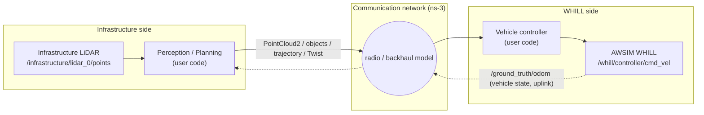
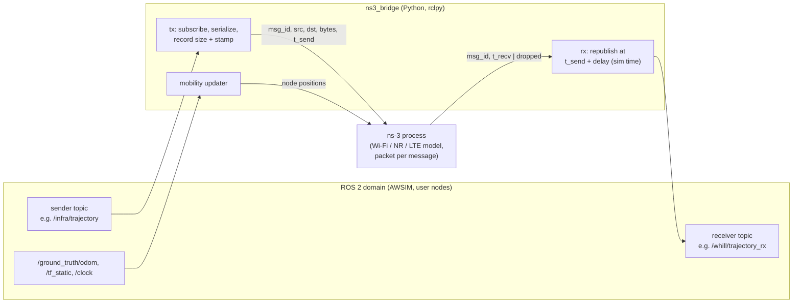

# Connecting AWSIM for WHILL to ns-3 (design study)

Goal: simulate the communication between the infrastructure LiDAR side and the WHILL with
[ns-3](https://www.nsnam.org/) (delay, loss, jitter, bandwidth). **Nothing of this document is
implemented yet**; it collects the data the integration needs, what AWSIM already provides, and a
proposed architecture. Numbers are measured on this repository unless marked *estimate*.

## 1. Data flow to simulate



Where the network is inserted depends on where the computation runs: raw point clouds
(perception on the vehicle), detections/tracks, a future trajectory, or a velocity command
(everything on the infrastructure side).

## 2. State needed by ns-3 (node positions, IDs, time)

| Data | Available from | Notes |
|---|---|---|
| WHILL position / orientation | `/ground_truth/odom` pose (`map`, base_link), 23.5 Hz | also `OptimizerBridge.get_current_odom` (TCP) |
| WHILL velocity | `/ground_truth/odom` twist (base_link) | |
| Infrastructure LiDAR position / orientation | `/tf_static` `map → infrastructure_lidar_<n>`; `config/infra_lidar.yaml` | static |
| Unit identifiers | frame ids: `infrastructure_lidar_<n>`, `base_link` | there is **no vehicle ID** (one WHILL only, see ROS2_INTERFACE.md §5) |
| Simulation time | `/clock` (Unity time, seconds since start, 100 Hz) | all message stamps use it |

Coordinates: `map` = Unity world in ROS axes. ns-3 mobility models use metres in a Cartesian frame,
so `map` x/y/z can be used directly (`ConstantPositionMobilityModel` for the sensors, positions of
the WHILL pushed each step, e.g. with `ConstantVelocityMobilityModel`).

## 3. Payloads

Serialized sizes (CDR, measured with `rclpy.serialization`) and rates:

| Payload | Message | Size per message | Rate | Data rate | Notes |
|---|---|---|---|---|---|
| Raw point cloud | `sensor_msgs/PointCloud2`, OS1-64, x,y,z,intensity,channel | **1 035 696 B** (≈43 150 points × 24 B) | 10 Hz | **≈ 83 Mbit/s** | measured in the corridor; scales with the number of returns (open space returns fewer points). Likely too much for a single wireless V2X link at range (*estimate*); compression (e.g. range image / Draco) or down-sampling would be needed |
| Raw point cloud, VLP16 class | `PointCloud2` 28 800 points | 691 200 B | 10 Hz | ≈ 55 Mbit/s | vehicle LiDAR, for comparison |
| Detections / tracks | e.g. `autoware_perception_msgs/TrackedObjects` | *estimate* ≈ 1 kB per object (pose, covariance, twist, shape) | 10 Hz | ≈ 0.1 Mbit/s for 10 objects | not produced by this repository |
| Future trajectory | `nav_msgs/Path`, N poses | **748 B (N=10), 2 188 B (N=30), 3 628 B (N=50)** | 10 Hz | ≈ 0.18 Mbit/s (N=30) | |
| Velocity command | `geometry_msgs/Twist` | **52 B** | 10–20 Hz | ≈ 4–8 kbit/s | AWSIM holds the last command |
| Vehicle state (uplink) | `nav_msgs/Odometry` | **716 B** | 23.5 Hz | ≈ 0.13 Mbit/s | |
| Collision / reset | `std_msgs/Bool` | 5 B | events | – | simulation control, not part of the network |

Effect of delay (qualitative):

- **PointCloud2**: dominated by serialization/transmission time (≈ 8 Mbit per cloud); at a few
  tens of Mbit/s the latency approaches the 100 ms frame period and frames queue up — loss of whole
  clouds (fragmented UDP) is the typical failure.
- **Detections / trajectory**: small; latency is dominated by medium access and retransmissions.
  A trajectory tolerates delay if it is time-stamped and the WHILL follows it from the current time
  (the trajectory carries its own validity horizon).
- **Twist**: smallest, but the control loop is closed over the network; delay directly adds dead
  time to the WHILL dynamics (per-wheel PID, see VEHICLE_MODEL.md) and loss freezes the last
  command (AWSIM keeps applying it — a watchdog is needed on the WHILL side).

## 4. Architecture options

### A. Application-level bridge with ns-3 in co-simulation (recommended)



- The bridge does not send the payload through ns-3, only its size and endpoints; ns-3 returns the
  delivery time or a drop. The payload itself is kept in the bridge and republished on the
  receiver topic when `/clock` reaches `t_recv`.
- Exchange between Python and ns-3: a socket/ZeroMQ protocol, or an existing module such as
  [ns3-ai](https://apps.nsnam.org/app/ns3-ai/) (shared memory) or
  [ns3-gym](https://github.com/tkn-tub/ns3-gym).
- Delay, loss and jitter come from the ns-3 channel/MAC model; bandwidth limits from the PHY rate.
  The same bridge can run with a statistical model (fixed delay, Gaussian jitter, Bernoulli loss)
  for tests without ns-3.

Bridge interface (proposal, one YAML entry per link):

```yaml
links:
  - name: trajectory_downlink
    in_topic: /infra/trajectory          # published by the infrastructure side
    out_topic: /whill/trajectory_rx      # what the WHILL side subscribes to
    type: nav_msgs/msg/Path
    src: infrastructure_lidar_0          # ns-3 node (position from /tf_static)
    dst: base_link                       # ns-3 node (position from /ground_truth/odom)
    qos: {reliability: reliable, depth: 1}
    fragment_bytes: 1400                 # how messages are split into packets
```

### B. Packet-level emulation (TapBridge / FdNetDevice)

Run the infrastructure-side and WHILL-side ROS 2 nodes in separate network namespaces or
containers whose interfaces are connected through ns-3 with
[TapBridge](https://www.nsnam.org/docs/models/html/tap.html) or
[FdNetDevice](https://www.nsnam.org/docs/models/html/fd-net-device.html), ns-3 running with
`RealtimeSimulatorImpl` ([emulation overview](https://www.nsnam.org/docs/models/html/emulation-overview.html)).
The real DDS traffic crosses the simulated network, so DDS discovery, fragmentation and
retransmissions are included. Drawbacks: ns-3 must keep up with real time (83 Mbit/s point
clouds are demanding), DDS must be configured per namespace (the provided `config/cyclonedds.xml`
binds to loopback), and wall-clock time drives the network while AWSIM stamps use `/clock`.

### C. Related work to reuse

Co-simulation of ROS / ROS 2 with ns-3 has been done before, e.g.
[CORNET 2.0](https://arxiv.org/pdf/2109.06979) (Gazebo/ROS + ns-3 via tap bridges),
[ROS-NetSim](https://arxiv.org/pdf/2101.10113), and a ROS 2 / 5G-LENA sidelink co-simulation
([sidewalk](https://github.com/vdesmond/sidewalk)). They were not evaluated for this repository.

## 5. Time synchronization issues

- AWSIM time (`/clock`) is Unity time; it runs approximately in real time but is not paced
  deterministically, and AWSIM cannot be stepped from outside (only `Time.timeScale` changes inside
  `OptimizerBridge.run_scenario`). A strict lock-step co-simulation needs a new AWSIM command
  ("advance by Δt and pause"), e.g. in `OptimizerBridge`.
- Option A tolerates this: the bridge schedules deliveries in `/clock` time, ns-3 runs in its own
  virtual time as fast as possible and only has to be ahead of `/clock`.
- Option B uses wall-clock time in ns-3; message stamps (sim time) and network delays (wall time)
  then differ by the AWSIM real-time factor.
- Point clouds are stamped with the time of the scene update, not with the scan time of each
  point (`time_stamp` field only in `_ex` clouds of the vehicle LiDAR).

## 6. Tasks to implement

1. `ns3_bridge` ROS 2 node (Python): link YAML, tx/rx queues keyed by `/clock`, statistical
   delay/loss model for testing.
2. ns-3 scenario: nodes for the infrastructure LiDARs (positions from `config/infra_lidar.yaml`)
   and the WHILL, chosen radio technology, application sending messages of the given size.
3. Exchange protocol bridge ↔ ns-3 (ns3-ai or socket), mobility updates from `/ground_truth/odom`.
4. Vehicle IDs and per-vehicle namespaces in AWSIM for more than one WHILL (ROS2_INTERFACE.md §5).
5. A watchdog on the WHILL side (zero command if no `cmd_vel` for T ms) — AWSIM keeps the last command.
6. Optional: an AWSIM "step / pause" command for strict lock-step.
7. Validation: compare bridge-reported delays with ns-3 traces; measure the control performance of
   the WHILL with increasing delay/loss.
