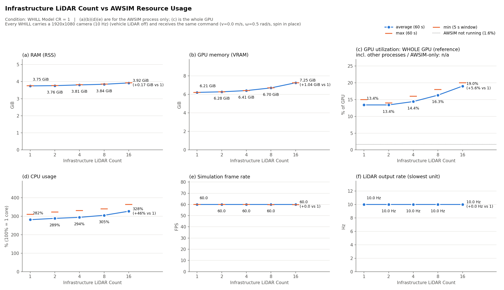
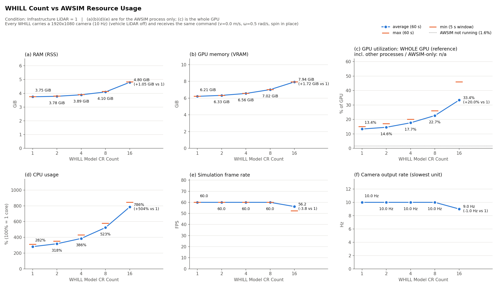

# Resource usage of AWSIM with more infrastructure LiDARs / WHILLs

Measured 2026-10-16 with `scripts/bench_resources.sh` (conditions and commands: README,
"Resource usage with more LiDARs / WHILLs"; parameters: `config/resource_bench.yaml`). The
purpose is a hardware estimate for scenarios with several sensors or vehicles, not a
performance benchmark.

## 1. Setup

| | |
|---|---|
| PC | AMD Ryzen Threadripper 9960X (24 cores / 48 threads), 256 GB RAM, NVIDIA RTX 5090 32 GB (driver 580.178.04), Ubuntu 22.04.5, two 3840×2160 displays at 60 Hz |
| AWSIM | default player `Builds/AWSIM_for_WHILL` (West Shinjuku, `AutowareSimulationDemo.unity`), window 1280×720, quality Ultra with VSync (**at most 60 FPS**) |
| Infrastructure LiDAR | Ouster OS1-64, 10 Hz, PointCloud2 on ROS 2; copies every 4 m along the WHILL heading |
| WHILL | `WhillModelCR` prefab (placeholder model, physics) with its 1920×1080 camera at 10 Hz (Image on ROS 2); **vehicle LiDAR (VLP16) switched off** on every WHILL |
| Load | every WHILL spins in place (v = 0, ω = 0.5 rad/s); no NPCs, no RL / optimizer clients |
| Other processes | desktop, browser, editor, Docker containers for the command and the checks: not included in RAM, VRAM, CPU and FPS (values of the AWSIM PID); included in the whole-GPU utilization |

Per condition: 60 s warm-up, then 60 samples at 1 Hz. In every condition every LiDAR published at
10 Hz, every camera published (10 Hz up to 8 WHILLs, at least 9.0 Hz with 16), and every WHILL kept
turning (yaw rate ≥ 0.2 rad/s in all status lines).

## 2. Results

| LiDARs | WHILLs | RAM mean [GiB] | VRAM [GiB] | CPU mean [%] (100 % = 1 core) | FPS mean / min | camera, slowest [Hz] | whole GPU, mean / max [%] (reference) |
|---:|---:|---:|---:|---:|---:|---:|---:|
| 1 | 1 | 3.75 | 6.21 | 282 | 60.0 / 60.0 | 10.0 | 13.4 / 15 |
| 2 | 1 | 3.76 | 6.28 | 289 | 60.0 / 59.9 | 10.0 | 13.4 / 14 |
| 4 | 1 | 3.81 | 6.41 | 294 | 60.0 / 60.0 | 10.0 | 14.4 / 16 |
| 8 | 1 | 3.84 | 6.70 | 305 | 60.0 / 59.8 | 10.0 | 16.3 / 18 |
| 16 | 1 | 3.92 | 7.25 | 328 | 60.0 / 59.8 | 10.0 | 19.0 / 20 |
| 1 | 2 | 3.78 | 6.33 | 318 | 60.0 / 59.9 | 10.0 | 14.6 / 17 |
| 1 | 4 | 3.89 | 6.56 | 386 | 60.0 / 59.9 | 10.0 | 17.7 / 20 |
| 1 | 8 | 4.10 | 7.02 | 523 | 60.0 / 60.0 | 10.0 | 22.7 / 26 |
| 1 | 16 | 4.80 | 7.94 | 786 | 56.2 / 52.2 | 9.0 | 33.4 / 46 |

Whole GPU without AWSIM: 1.6 % mean, 15 % max, 1.77 GiB VRAM used (60 s). The per-process GPU
utilization of NVML is in `summary.csv` (`GPU_utilization_*`) but unreliable (missing samples).

## 3. Increment per added unit (1 → 16)

| | RAM | VRAM | CPU | frame rate |
|---|---:|---:|---:|---|
| infrastructure LiDAR (OS1-64, 10 Hz) | +12 MiB | +71 MiB | +3 % (0.03 core) | 60 FPS up to 16 |
| WHILL with camera (1920×1080, 10 Hz) | +72 MiB | +118 MiB | +34 % (0.34 core) | 60 FPS up to 8; 16: 56 FPS (min 52), camera 9 Hz |

Estimate on this PC (up to 16 units):

- RAM ≈ 3.75 GiB + 0.012 GiB × (LiDARs − 1) + 0.07 GiB × (WHILLs − 1)
- VRAM ≈ 6.2 GiB + 0.07 GiB × (LiDARs − 1) + 0.115 GiB × (WHILLs − 1)
- CPU ≈ 2.8 cores + 0.03 core × (LiDARs − 1) + 0.34 core × (WHILLs − 1)

The fixed part (map, one WHILL, one LiDAR) dominates RAM and VRAM. What limits first when units are
added is the CPU and the rendering of the cameras (frame rate and camera output rate fell at 16
WHILLs); on a PC with fewer cores or a smaller GPU this is expected to happen with fewer WHILLs (not
tried on other PCs). LiDARs are cheap: 16 of them cost about 1 GiB VRAM and half a core. The
GPU memory of the rest of the system (desktop, Docker, a DreamerV3 training: several GiB) comes on
top.

## 4. Notes

- The WHILL copies share `/whill/controller/cmd_vel` (one command drives all); their sensor
  topics are separate (`/bench/whill_<i>/...`). This is enough for the measurement, not a
  multi-vehicle setup (README, "Several WHILLs").
- With the vehicle LiDAR switched on (the default prefab), a VLP16 per WHILL is added; a trial
  with 16 WHILLs and vehicle LiDARs ran at about 30 FPS (not part of the table).
- One run per condition (60 s). Resolution, rate and LiDAR model change the numbers.
- An earlier measurement with a different AWSIM build of the same project (with the original,
  non-public WHILL 3D model and the camera at 7.5-8.2 Hz) gave the same order: +9 MiB / +71 MiB VRAM per LiDAR,
  +50 MiB / +118 MiB VRAM / +0.17 core per WHILL, 16 WHILLs at 59 FPS. The higher CPU per WHILL
  here is probably due to the camera running at the full 10 Hz (not separated).
