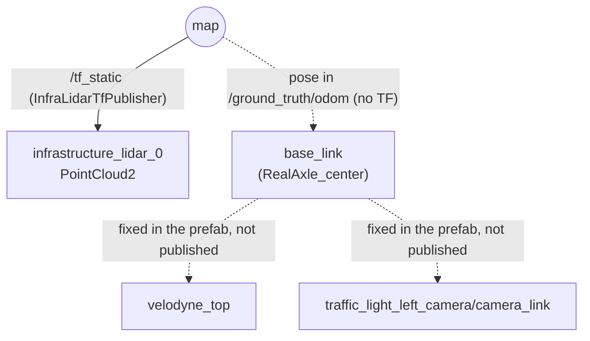

# ROS 2 interface

ROS 2 Humble, CycloneDDS (`rmw_cyclonedds_cpp`), domain `ROS_DOMAIN_ID` (default 0).
AWSIM runs one ROS 2 node `/AWSIM` (Ros2ForUnity, standalone build). A few components create
their own nodes (`/ground_truth_publisher_<id>`, `/wheel_speed_publisher`,
`/collision_publisher_<id>`), and the LiDAR point clouds are published by the native RGL library
(node `/RobotecGPULidar`).

Values in the tables come from the source code / serialized settings, and the **measured**
columns from `ros2_examples/check_interfaces.py` (RTX 5090, corridor scene, standalone player,
10 s, see [TEST_REPORT.md](TEST_REPORT.md)). No namespace is used: every name below is absolute.

## 1. Inputs (AWSIM subscribes)

| Topic | Type | QoS | Effect | Component |
|---|---|---|---|---|
| `/whill/controller/cmd_vel` | `geometry_msgs/Twist` | RELIABLE, **TRANSIENT_LOCAL**, KEEP_LAST 1 | `linear.x` = v [m/s], `angular.z` = ω [rad/s] (+ = left). Held until the next message. See [VEHICLE_MODEL.md §3](VEHICLE_MODEL.md) | `AccelVehicleRos2Input` |
| `/control/command/gear_cmd` | `autoware_vehicle_msgs/GearCommand` | same | **Required once**: `command: 2` (DRIVE). The WHILL starts in PARKING and ignores cmd_vel there | `AccelVehicleRos2Input` |
| `/control/command/control_cmd` | `autoware_control_msgs/Control` | same | Upstream acceleration/steering input. Steering is forced to 0 and the drive force comes only from cmd_vel; a non-zero acceleration only disables the coasting deceleration | `AccelVehicleRos2Input` |
| `/control/command/turn_indicators_cmd`, `/control/command/hazard_lights_cmd`, `/control/command/emergency_cmd` | Autoware / TIER IV msgs | same | No effect on the WHILL (emergency: empty handler upstream) | `AccelVehicleRos2Input` |
| `/reset_command` | `std_msgs/Bool` | RELIABLE, VOLATILE | `true`: WHILL back to the start pose (velocities zeroed, gear DRIVE), obstacle(s) re-placed (randomized), answer on `/reset_response` | `EnvironmentReset` (corridor scene) |
| `/awsim/episode/start_pose` | `geometry_msgs/Pose` | RELIABLE, VOLATILE | Start pose of **base_link** in `map` for the next resets (z ignored) | `EnvironmentReset` |
| `/awsim/episode/goal` | `geometry_msgs/Point` | RELIABLE, VOLATILE | Moves the goal object (x, y in `map`) | `EnvironmentReset` |
| `/awsim/awsim_rviz_plugins/pose_teleport/pose_with_covariance` | `geometry_msgs/PoseWithCovarianceStamped` | RELIABLE, VOLATILE | Upstream RViz "2D pose teleport". **Wired to the inactive Lexus, does not move the WHILL** | `AwsimRvizPluginsClient` |
| `/awsim/awsim_rviz_plugins/npc_spawner/*` | | | Upstream NPC spawner (no NPC prefabs configured in this scene) | `AwsimRvizPluginsClient` |

Service: `/input/control_mode_request` (`autoware_vehicle_msgs/srv/ControlModeCommand`) switches
AUTONOMOUS (ROS 2 input, default) / MANUAL (keyboard). Pressing a driving key in the AWSIM window
switches to MANUAL. The keyboard input only provides an acceleration/steering command, which the
differential-drive AccelVehicle does not turn into a drive force (from the code; not tested): the
WHILL is driven through `cmd_vel` (or `OptimizerBridge.send_cmd_vel`) only. If the WHILL stops
reacting after a key press, switch back to AUTONOMOUS (the `C` key or the service above).

Outside ROS 2: `OptimizerBridge` listens on **TCP 127.0.0.1:50051** (length-prefixed JSON:
`ping`, `set_parameters`, `get_parameters`, `reset_simulation`, `send_cmd_vel`,
`get_current_odom`, `run_scenario`). Used by `whill_optimizer`.

### Minimal commands

```bash
# gear DRIVE once, then 0.3 m/s forward while turning left at 0.2 rad/s
ros2 topic pub --once --qos-reliability reliable --qos-durability transient_local \
  /control/command/gear_cmd autoware_vehicle_msgs/msg/GearCommand "{command: 2}"
ros2 topic pub -r 10 --qos-reliability reliable --qos-durability transient_local \
  /whill/controller/cmd_vel geometry_msgs/msg/Twist "{linear: {x: 0.3}, angular: {z: 0.2}}"
```

A publisher with **VOLATILE** durability (the default QoS of rclpy / rclcpp publishers) is **not
matched** by AWSIM's TRANSIENT_LOCAL subscription: the publisher logs "requesting incompatible QoS
… DURABILITY" and the WHILL does not move (tested). Use TRANSIENT_LOCAL in your nodes.
`ros2 topic pub` of Humble already uses transient_local by default (tested); the flags above only
make it explicit.

## 2. Outputs (AWSIM publishes)

| Topic | Type | QoS | frame_id | Rate (setting → **measured**) | Content / unit | Component |
|---|---|---|---|---|---|---|
| `/clock` | `rosgraph_msgs/Clock` | RELIABLE, VOLATILE, 1 | – | 100 Hz → **99.3 Hz** | Simulation time, see §4 | `ClockRos2Publisher` |
| `/ground_truth/odom` | `nav_msgs/Odometry` | RELIABLE, VOLATILE, 10 (node default) | `map` → child `base_link` | 30 Hz → **23.5 Hz** (counter reset in `Update`, so below 30 at ~70 fps) | Pose of `RealAxle_center` (center of the drive axle) in `map`; twist in `base_link` (m/s, rad/s). No covariance | `GroundTruthPublisher` |
| `/infrastructure/lidar_0/points` | `sensor_msgs/PointCloud2` | BEST_EFFORT, VOLATILE, 5 | `infrastructure_lidar_0` | 10 Hz → **10.0 Hz** | Ouster OS1-64, x,y,z,intensity,channel (24 B/point); **≈43 150 points, 1.04 MB** per message in the corridor | `RglLidarPublisher` (config/infra_lidar.yaml) |
| `/sensing/lidar/top/pointcloud_raw` | `sensor_msgs/PointCloud2` | BEST_EFFORT, VOLATILE, 5 | `velodyne_top` | 10 Hz → **10.0 Hz** | Vehicle VLP16, 28 800 points, 0.69 MB | `RglLidarPublisher` |
| `/sensing/lidar/top/pointcloud_raw_ex` | `sensor_msgs/PointCloud2` | same | `velodyne_top` | **10.0 Hz** | Same points with return type, azimuth, elevation, distance, time stamp; 0.92 MB | `RglLidarPublisher` |
| `/sensing/camera/traffic_light/image_raw` | `sensor_msgs/Image` | BEST_EFFORT, VOLATILE, 1 | `traffic_light_left_camera/camera_link` | → **7.9 Hz** | 1920×1080 `bgr8`, 6.2 MB. Observation of the DreamerV3 task | `CameraRos2Publisher` |
| `/sensing/camera/traffic_light/camera_info` | `sensor_msgs/CameraInfo` | same | same | **7.9 Hz** | | `CameraRos2Publisher` |
| `/whill/wheel_velocities_sim` | `std_msgs/Float32MultiArray` | RELIABLE, VOLATILE, 10 | – | 60 Hz → **39.4 Hz** | `[left measured, right measured, left target, right target]` drive-wheel ground speeds [m/s] | `WheelSpeedPublisher` |
| `/collision_sensor` | `std_msgs/Bool` | RELIABLE, VOLATILE, 10 | – | on event (cool-down 0.5 s) | `true` when the WHILL touches an object tagged `Obstacle` | `CollisionPublisher` |
| `/reset_response` | `std_msgs/Bool` | RELIABLE, VOLATILE | – | on reset | `true` after a reset | `EnvironmentReset` |
| `/awsim/goal_position` | `geometry_msgs/Point` | RELIABLE, VOLATILE | (`map`) | 1 Hz and after every reset/goal change | Goal object position in `map` [m] | `EnvironmentReset` |
| `/tf_static` | `tf2_msgs/TFMessage` | RELIABLE, **TRANSIENT_LOCAL**, 1 | `map` → `infrastructure_lidar_<n>` | once (again if a sensor moves) | Pose of each infrastructure LiDAR | `InfraLidarTfPublisher` |
| `/vehicle/status/velocity_status`, `gear_status`, `control_mode`, `steering_status`, `turn_indicators_status`, `hazard_lights_status` | `autoware_vehicle_msgs/*Report` | system default (prefab) | `base_link` | 30 Hz | Upstream Autoware vehicle reports | `AccelVehicleReportRos2Publisher` |

Not published although components exist: IMU (`/sensing/imu/tamagawa/imu_raw`) and GNSS
(their initialization is commented out in `EgoVehicle.cs`), V2I (`_useV2i = false`).

Units: SI (m, m/s, rad, rad/s). Positions in `map` follow the AWSIM convention
`ROS (x, y, z) = Unity (z, −x, y)`.

## 3. Frames and TF

AWSIM itself publishes **no `/tf`**. The only transforms are the static ones added by this
project for the infrastructure LiDARs. The other frames exist only as `header.frame_id` /
`child_frame_id` of messages.



| Frame | Defined by | Pose |
|---|---|---|
| `map` | Unity world in ROS axes | – |
| `base_link` | `RealAxle_center` | `/ground_truth/odom` |
| `infrastructure_lidar_0` | `config/infra_lidar.yaml` | `/tf_static`: t = (−0.20, 6.30, 1.65) m |
| `velodyne_top` | VelodyneVLP16 in the prefab | vehicle frame (−0.014, 0.383, 0.361) m Unity axes, see VEHICLE_MODEL.md; **no TF** |
| `traffic_light_left_camera/camera_link` | CameraSensor in the prefab | vehicle frame (0.326, 0.916, 0.287) m; **no TF** |

There is no `odom` frame. To use the vehicle-mounted sensors with TF, publish
`map → base_link` from `/ground_truth/odom` and static `base_link → sensor` transforms yourself
(values in VEHICLE_MODEL.md).

## 4. Time

- Time source of the scene: `TimeSourceType.Unity` (`_timeSourceType = 0`), i.e. Unity
  `Time.timeAsDouble`: **seconds since the start of the player**, scaled by `Time.timeScale`, not
  wall-clock/epoch time.
- `/clock` is published from a separate thread at 100 Hz with the time last read on the Unity
  main thread (`UnityTimeSource`); between two frames the same value is published again.
- Stamps: `/ground_truth/odom` uses `Time.timeAsDouble` directly; the camera, the vehicle reports
  and the RGL point clouds use `AwsimRos2Node.GetTime` (same source). Measured median of
  `header.stamp − latest /clock`: odom +0.018 s, image +0.017 s, point clouds 0.000 s,
  i.e. within one frame (≈14 ms at the measured frame rate). All stamps share the `/clock`
  time base.
- ROS 2 nodes that use these stamps must run with `use_sim_time:=true`
  (e.g. `ros2 run ... --ros-args -p use_sim_time:=true`); with wall-clock time, message stamps
  look ~1.8·10⁹ s old.
- Pause / time scale (from the code, not measured): when Unity is paused or
  `Time.timeScale = 0`, `Time.timeAsDouble` stops, so `/clock` keeps being published with a constant
  value and every stamp freezes; after resuming it continues from that value (no jump).
  `OptimizerBridge.run_scenario` changes `Time.timeScale` for its duration.
- The DreamerV3 environment does **not** use sim time: it waits for a new camera frame per step
  and measures its episode timeout in wall-clock seconds.

## 5. Several WHILLs

Not supported. What collides with a second `WhillModelCR` instance:

| Item | Problem |
|---|---|
| Topics | All topic names are absolute strings in the components (cmd_vel, odom, LiDAR, camera, collision, wheel speeds, vehicle reports). Both vehicles would subscribe/publish the same topics |
| Frames | `base_link`, `velodyne_top`, camera frame identical |
| Node names | `wheel_speed_publisher` is a fixed node name (duplicate node names) |
| OptimizerBridge | Fixed port 50051; the second bridge fails to bind |
| Scene controller | `AutowareSimulationDemo` initializes and updates **one** `EgoVehicle`; a second WHILL is never initialized and does not drive |
| EnvironmentReset | Finds the first `AccelVehicle` only |
| Vehicle ID | None |

Needed changes: (1) let the scene controller initialize and update a list of `EgoVehicle`s,
(2) a per-vehicle namespace applied in `Awake` (before the components create their publishers) to
every topic string and frame id under the vehicle (`/<ns>/whill/controller/cmd_vel`,
`<ns>/base_link`, ...), (3) unique node names and OptimizerBridge ports (port + index), (4)
EnvironmentReset per vehicle or keyed by namespace. Item (1) changes upstream scene code and
the UI bindings, so the namespace feature was not implemented in this release.
